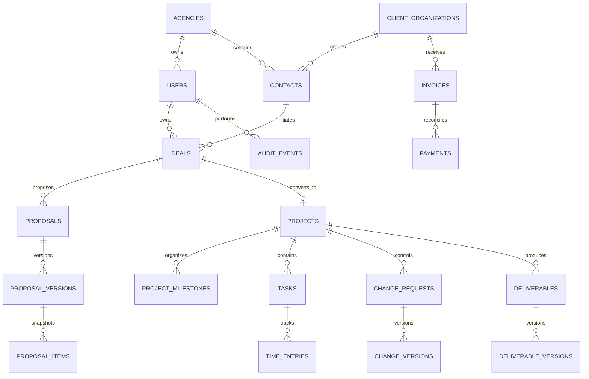
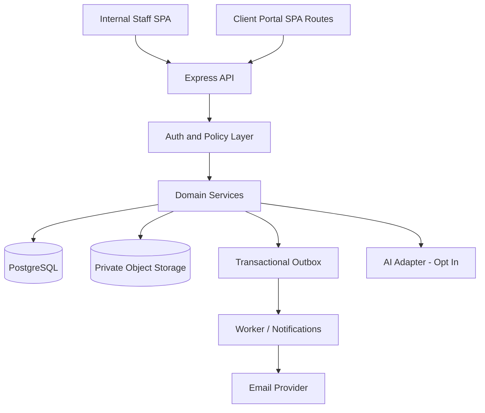

# CLIENTFLOW — PRODUCT, ENGINEERING, SECURITY & UX MASTER SPECIFICATION

**A premium, secure Agency Operations Platform for Software & Digital Agencies**  
**Version:** 1.0 | **Status:** Implementation blueprint, not implemented | **Date:** 24 October 2026  
**Language:** English | **Reference users:** owner, sales team, project managers, delivery team, finance, invited clients  
**Primary stack:** React + TypeScript + Vite / Node.js + Express + TypeScript / PostgreSQL + Prisma

> **HANDOFF RULE:** This document is the source of truth for implementation. Every feature is a requirement to implement in its specified release phase, NOT a claim that it already exists. Do not generate a static prototype and call it done. Do not claim deployment, test passes, or security compliance without evidence. Start with the thin vertical slice and expand in verifiable milestones. If any requirement conflicts with another, record an Architecture Decision Record (ADR) and resolve before implementation.

---

## 0. Executive summary

**ClientFlow** is a responsive internal agency operations web app with a carefully scoped client portal. It helps a services agency track the entire business workflow:

**Inquiry / Lead -> Qualification -> Deal -> Versioned Proposal -> Client Acceptance -> Project Handoff -> Tasks and Deliverables -> Approval and Change Requests -> Invoice Tracking -> Reporting / Retention.**

The core differentiator is **continuity of context and defensible project scope**. Agencies should know exactly what was promised, who approved it, what is being delivered, how long work takes, what changes were requested, which payments are outstanding, and what is falling behind — without losing client context when a deal becomes a project.

### 0.1 Business problem and evidence-informed hypotheses

| Client pain | Product response | How value will be validated |
|---|---|---|
| Leads and follow-ups fall through the cracks | Contact/deal ownership, next action, reminders, overdue queues | Count overdue follow-ups, % deals with next step |
| Scope creep causes unbilled work | Proposal scope snapshot, change-request workflow with explicit acceptance | % change work with recorded approval, count unapproved changes |
| Poor sales-to-delivery handoffs | Atomic Won-to-Project conversion and handoff checklist | Time to first project task, incomplete handoff rate |
| Client feedback is scattered across email/chats | Deliverable review pages, explicit decision and revision requests | Median time to approval, number of pending approvals |
| Hard to tell what is profitable | Time tracking + rate/cost assumptions + invoice status dashboard | Coverage of time logs and project margin estimates |
| Deadlines and dependencies are invisible | Project work board, owners, due dates, blocked state | Overdue tasks and blocked items by owner |
| Sensitive information shared too widely | Role + record-scoped access, client portal isolation, audit events | Zero unauthorized access in negative tests |
| Repetitive admin slows work | Templates, CSV imports, scheduled reminders, optional safe AI drafts | Minutes saved vs manual workflow in pilot |

**Research inputs (directional, not guarantees of product-market fit):** 2025 Ignition agency cash-flow/scope-creep research; 2026 COR agency operations report; Teamwork agency operations survey; 2025 HubSpot sales outcomes study. See Section 29. Verify product fit with 5-10 actual agency users before commercializing.

### 0.2 What ClientFlow is / is not

- **Is:** internal CRM + lightweight agency work management + quotation/change-control/approvals + financial visibility + client collaboration.
- **Is not (v1):** replacement for a complete ERP, payroll processor, tax/accounting system, bank/payment gateway, enterprise resource-planning suite, legal e-signature system, or autonomous AI agent.
- **Deployment model:** single agency installation in v1, with an `agency_id` data boundary from day one; multi-tenant SaaS and self-service signup are future work requiring a separate security review.
- **Default workspace locale:** English; store UTC timestamps, default agency timezone `Africa/Cairo`, default display currency EGP (configurable). Support locale-ready UI design; Arabic/RTL is a later tested enhancement.

### 0.3 Non-negotiable success criteria

1. The system can execute a complete realistic journey using PostgreSQL — no mocked data in production flows.
2. Every read and write enforces both **role permission and specific record access** on the server.
3. A client can view only explicitly shared projects, deliverables, approvals and invoices; never internal costs, margins, staff notes or other client records.
4. Versioned proposals and change orders are immutable after acceptance; revisions create new versions.
5. Critical business transitions are idempotent/transactional and auditable.
6. Desktop, tablet and mobile screens are usable, keyboard accessible and visually coherent.
7. Automated tests cover critical happy paths and negative authorization, concurrency and financial calculations.
8. Production setup includes secure configuration, migrations, backup/restore drill, observability and deployment notes.
9. Optional AI is off by default, opt-in, transparent, permission-scoped and human-reviewed.
10. All acceptance criteria can be demonstrated with seeded fictional demo data and recorded test results.

---

## 1. Personas, jobs to be done, and access model

| Persona | Main need | Sample success task |
|---|---|---|
| Agency Owner (`OWNER`) | See pipeline, team workload, cash exposure and project health | Open dashboard and identify overdue client approvals |
| Agency Admin (`ADMIN`) | Configure workspace, team, service catalog and policies | Invite member, configure stage names, revoke access |
| Sales Manager (`SALES_MANAGER`) | Monitor opportunities, assign sales reps, approve proposal drafts | Move a deal, review outstanding quotes |
| Sales Representative (`SALES`) | Manage assigned leads/deals and next actions | Qualify lead and create a scoped draft proposal |
| Project Manager (`PM`) | Take ownership of won work and track deliverables and scope | Create milestones, assign tasks, submit approval request |
| Delivery Team Member (`MEMBER`) | Focus on assigned work and log time | Complete assigned task and add timesheet entry |
| Finance (`FINANCE`) | Track authorized invoices and payment status | Record a confirmed manual payment reference |
| Client Portal User (`CLIENT`) | Review shared work without internal clutter | Approve deliverable or request revision |

**Permission composition:** Roles grant capabilities, but *record ownership, project membership, assignment, client organization association, and explicit sharing* determine which individual rows are accessible. Deny by default. The interface may hide unavailable actions but backend checks always decide.

### 1.1 Permission matrix (base policy)

`A=all agency records`, `O=owned/assigned or explicit team scope`, `P=participating project`, `C=client-organization-owned AND explicitly published`, `—=denied`.

| Capability | OWNER | ADMIN | SALES_MANAGER | SALES | PM | MEMBER | FINANCE | CLIENT |
|---|---|---|---|---|---|---|---|---|
| View internal KPI aggregates | A | A | Sales aggregates | O | P | O | Financial aggregates | — |
| Manage agency settings/roles | A | A | — | — | — | — | — | — |
| View/edit contacts and deals | A | A | A | O | P linked | — | Limited billed customer | — |
| Create/submit proposals | A | A | A | O draft | P draft | — | Read shared | — |
| Approve internal proposal release | A | A | A | — | — | — | — | — |
| Manage projects and scope changes | A | A | — | Read linked | P | Assigned tasks | Read billing parts | — |
| Update delivery tasks | A | A | — | — | P | Assigned | — | — |
| Submit own time | A | A | — | — | P | Own | — | — |
| View internal cost/margin | A | Authorized admin | — | — | P estimate only | — | A | — |
| Manage invoice state | A | A | — | — | Read P | — | A | — |
| Review published deliverables | — | — | — | — | — | — | — | C |
| Accept client proposal/change | — | — | — | — | — | — | — | C via invitation |
| View client portal invoices | — | — | — | — | — | — | — | C published |

**Policy decisions:** Internal proposal approval and external client acceptance are distinct. Client approval requires a verified portal session with organization association; do not treat a bare shared URL as authorization. Final role rules should be encoded as declarative permissions plus resource checks and tested across all APIs.

---

## 2. Release scope and prioritization

A genuinely complete product is built in increments, not a single giant unverified code generation. **All items below must be tracked**, with release ownership and explicit status. Phase labels indicate build order, not optional quality.

### Phase 0 — Foundation / vertical slice (M0-M2)

- [ ] Monorepo, pinned dependencies, formatter/linter/typecheck.
- [ ] Local Docker PostgreSQL, reproducible environment, seed, migrations.
- [ ] Express API with versioning, unified errors, request IDs, log sanitization.
- [ ] React shell, design tokens, layout primitives, routing, responsive navigation.
- [ ] Secure owner bootstrap, login/logout, sessions, CSRF protection, auth middleware.
- [ ] RBAC + object scope, authorization tests.
- [ ] One working lead create/list/detail flow using real DB and authenticated API.

### Phase 1 — Complete sales CRM (M3-M5)

- [ ] Contacts/leads, activities, duplicates, source, tags, owners, search, pagination.
- [ ] Deals, configurable pipeline stages, probabilities only if explicitly defined, won/lost reasons.
- [ ] Follow-ups, tasks, reminders and notifications in app; reliable email optional if configured.
- [ ] Proposal builder: service catalog, itemized prices, discounts/taxes as configurable input, expiry, versions, PDF rendering.
- [ ] Internal proposal review + client acceptance/rejection/feedback in portal.
- [ ] Sales dashboard, saved filters, CSV exports with permissions.

### Phase 2 — Agency delivery and retention (M6-M9)

- [ ] Atomic accepted/won deal handoff into project with agreed scope snapshot.
- [ ] Project template, milestones, phases, task list/board, assignees, dependencies/blocked.
- [ ] Deliverable library, private document storage, published items, client approval cycle.
- [ ] Formal change requests with scope, effort, budget, and explicit acceptance before execution.
- [ ] Time tracking per task (manual timer optional), billable flag, staff cost/rate policy.
- [ ] Manual invoice schedule and payment-status tracking; no real payment processing.
- [ ] Project health, capacity hints, estimated vs actual hours and margin (label estimates).
- [ ] Client portal for invited and verified users, scoped to published content.

### Phase 3 — Professionalization and commercial readiness (M10-M12)

- [ ] Automation rules/templates: reminders, stale lead alerts, due tasks, approvals.
- [ ] CSV import preview/validation/error report, safe export, duplicate handling.
- [ ] Robust accessibility, motion preferences, mobile, cross-browser and 200% zoom tests.
- [ ] Secure deployment, rate limits, backups and restore, monitoring, incident runbook.
- [ ] Full end-to-end test suite, performance checks, error budget and bug bash.
- [ ] Showcase data and guided tour, documentation, portfolio case study.

### Phase 4 — Optional differentiators, OFF by default (M13+)

- [ ] AI-assisted meeting summary / follow-up draft with review, citations to allowed records.
- [ ] AI-supported proposal outline with deterministic pricing and explicit review.
- [ ] Predictive deal scoring only with genuine training/evaluation data; avoid fake accuracy claims.
- [ ] More integrations (calendar sync, accounting export, WhatsApp via approved API only).
- [ ] Arabic/RTL, multi-workspace SaaS and payment gateway only after independent scoping.

**Hard rule:** Phase 1 must run end-to-end before Phase 2 expands. Phase 3 security and quality gates apply to every phase, not only at the end.

---

## 3. Detailed functional requirements

IDs are permanent. Each task must link to one or more `FR` IDs and one or more tests.

### 3.1 Identity & workspace administration

| ID | Requirement | Priority |
|---|---|---|
| FR-I01 | First-run CLI creates a single owner atomically, refusing a second bootstrap | P0 |
| FR-I02 | Login with email and password; account enumeration-safe errors; brute-force protection | P0 |
| FR-I03 | Server sessions stored with hash of random token; rotation on login/privilege change, logout and expiry | P0 |
| FR-I04 | Owner/Admin invites users with one-time expiring invitation and chooses role | P0 |
| FR-I05 | Invitee sets password, verifies invitation once; invalid/reused/expired tokens are rejected | P0 |
| FR-I06 | Password reset with one-time expiring token, throttled endpoints, notification | P1 |
| FR-I07 | Profile display name, timezone, avatar optional, language preference | P1 |
| FR-I08 | Admin can deactivate, reactivate and revoke sessions; prevent removal of sole owner | P0 |
| FR-I09 | Agency profile, logo, contact information, currency, timezone and working days | P1 |
| FR-I10 | Agency-specific pipeline stages and service catalog are configurable | P1 |
| FR-I11 | Roles + record scoping enforced by every route/service/query | P0 |
| FR-I12 | Important security events produce redacted audit records | P0 |

### 3.2 Lead & client relationship management

| ID | Requirement | Priority |
|---|---|---|
| FR-C01 | Create, view, edit, archive contacts with lead/customer lifecycle and optional company association | P0 |
| FR-C02 | Required name; email/phone optional but validate if supplied; notes length limits | P0 |
| FR-C03 | Store acquisition source, tags, owner, status, and next action date | P1 |
| FR-C04 | List filtering by owner, lifecycle, status, source, tag, date; server-side pagination/sort | P1 |
| FR-C05 | Search by normalized name/email/company/phone without leaking unscoped records | P1 |
| FR-C06 | Duplicate suggestions on normalized email/phone, no silent data merge | P1 |
| FR-C07 | Convert LEAD to CUSTOMER in place; preserve ID, deals, activities | P1 |
| FR-C08 | Timeline combines notes, calls, tasks, emails manually recorded and change events | P1 |
| FR-C09 | Track contact communication preference and consent status; opt-out respected | P2 |
| FR-C10 | CSV import preview, map columns, deduplicate, reject rows and summarize | P3 |

### 3.3 Sales pipeline & deals

| ID | Requirement | Priority |
|---|---|---|
| FR-D01 | Create/edit/archive deals with contact, owner, service interest, amount, currency, next step | P1 |
| FR-D02 | Pipeline stages have scoped stable IDs, ordered positions; closed status distinct from stage | P1 |
| FR-D03 | List and Kanban with keyboard-accessible stage change fallback | P1 |
| FR-D04 | Allowed transitions and `version` optimistic locking; stale edits return 409 | P1 |
| FR-D05 | Mark LOST only with reason, mark WON only with accepted proposal or documented authorized override | P1 |
| FR-D06 | Deal closing writes event once; repeat requests are idempotent | P1 |
| FR-D07 | Show deals without future actions and overdue follow-ups | P1 |
| FR-D08 | Owner/Admin can reassign a deal and record reassignment in history | P1 |

### 3.4 Service catalog, proposals and client acceptance

| ID | Requirement | Priority |
|---|---|---|
| FR-Q01 | Service catalog includes name, description, default unit, rate, archived status | P1 |
| FR-Q02 | Draft proposal contains title, client, scope inclusions/exclusions, milestones, line items, terms, currency, expiry | P1 |
| FR-Q03 | Server performs decimal-safe total calculation; any configured tax/discount is explicit and explained | P1 |
| FR-Q04 | Proposal revision creates immutable numbered snapshot; accepted versions never overwritten | P1 |
| FR-Q05 | Internal approval workflow before sending a client-visible version | P1 |
| FR-Q06 | PDF export matches accepted version and displays reference number, amounts and dated acceptance | P1 |
| FR-Q07 | Client may accept/reject/request changes only as verified authorized portal user | P2 |
| FR-Q08 | Expired or superseded proposal versions cannot be accepted | P1 |
| FR-Q09 | Acceptance stores authenticated actor, timestamp, version and displayed terms hash | P2 |
| FR-Q10 | Deal-to-project handoff uses accepted version as scope source of truth | P2 |
| FR-Q11 | If electronic acceptance is insufficient for client's legal jurisdiction, show it as operational approval, not formal e-signature | P1 |

### 3.5 Projects, milestones and tasks

| ID | Requirement | Priority |
|---|---|---|
| FR-P01 | Create project through atomic won-deal handoff; direct manual project creation limited to Admin/PM | P2 |
| FR-P02 | Handoff stores proposal snapshot, project owner, client, budget baseline and checklist | P2 |
| FR-P03 | Project states: PLANNED, ACTIVE, ON_HOLD, COMPLETED, ARCHIVED | P2 |
| FR-P04 | Milestones have title, target date, state and sequence | P2 |
| FR-P05 | Task has assignee, project, optional milestone, due date, priority, status, estimated hours | P2 |
| FR-P06 | Tasks can be blocked by other tasks; prevent circular dependencies | P2 |
| FR-P07 | Task state board with accessible non-drag fallback and server authorization | P2 |
| FR-P08 | Time entry records task, author, date, duration minutes, billable flag, internal note | P2 |
| FR-P09 | Only assignee/PM/Admin can change relevant task fields; internal costs restricted | P2 |
| FR-P10 | Handoff and task completion emit activity and notification events | P2 |
| FR-P11 | Project archived records remain in history and exports subject to retention policy | P2 |

### 3.6 Scope changes and delivery approvals

| ID | Requirement | Priority |
|---|---|---|
| FR-S01 | Client/PM can submit change request with requested delta and justification | P2 |
| FR-S02 | PM estimates impact: hours, price, delivery date and work items; internal approval if required | P2 |
| FR-S03 | Client-visible proposed change has immutable version and explicit accept/reject action | P2 |
| FR-S04 | New scope becomes effective only after approval by authorized client user | P2 |
| FR-S05 | Any creation of out-of-scope billable task requires approved change reference or authorized documented exception | P2 |
| FR-S06 | Deliverables are created privately, then published explicitly to selected client organization | P2 |
| FR-S07 | Client can approve, reject with reason, or request revisions on published deliverables | P2 |
| FR-S08 | Revisions preserve historical versions, reviewer, timestamp and decision | P2 |
| FR-S09 | Approvals show due date, status, reminders and explicit overdue flag | P2 |
| FR-S10 | No implicit approval from silence unless policy is explicitly agreed, recorded and legally reviewed | P2 |

### 3.7 Client portal, collaboration and files

| ID | Requirement | Priority |
|---|---|---|
| FR-X01 | Client users belong to a verified client organization and one or more explicitly shared projects | P2 |
| FR-X02 | Client portal navigation is distinct from internal workspace navigation | P2 |
| FR-X03 | Portal displays only published project status, milestones, deliverables, approvals and selected invoices | P2 |
| FR-X04 | Internal notes, staff rates/costs, margin, other client data and unrelated personnel are invisible | P0 |
| FR-X05 | Files are private by default; short-lived authorized download URLs; file type/size limits | P2 |
| FR-X06 | Upload quarantine/scan pipeline or safe provider-based scanning before published availability | P2 |
| FR-X07 | Uploaded HTML/SVG/active content is rejected or served safely isolated, never same-origin executable content | P2 |
| FR-X08 | Client comments have author/time/edit history and access restrictions | P2 |
| FR-X09 | Notification settings per category/channel and accessible unread center | P2 |

### 3.8 Invoice status, financial views and reporting

| ID | Requirement | Priority |
|---|---|---|
| FR-F01 | Track invoice drafts, issued, partially paid, paid, overdue, void; do not process bank/card payments | P2 |
| FR-F02 | Invoice snapshots include customer identity, line items, currency, due date and reference number | P2 |
| FR-F03 | Partial payments are additive recorded transactions with actor/date/reference; overpayment needs explicit handling | P2 |
| FR-F04 | Finance/Owner only may change payment status; every change audited | P2 |
| FR-F05 | Project revenue expected/issued/received must be clearly distinguished | P2 |
| FR-F06 | Time cost estimate = approved minutes × internal costing rate, with currency policy | P2 |
| FR-F07 | Profitability is labeled estimated, shows data completeness, excludes unentered costs | P2 |
| FR-F08 | Dashboard filters by date, owner, project and status with permitted aggregates | P1/P2 |
| FR-F09 | Export to CSV/PDF is scope-limited and contains no unpermitted data | P2 |
| FR-F10 | Financial numbers consistently use minor-unit integer or decimal arithmetic, never binary floats | P0 |

### 3.9 Automation, integrations, administration

| ID | Requirement | Priority |
|---|---|---|
| FR-A01 | In-app reminder for overdue follow-up, task, proposal expiry, pending approval | P1/P2 |
| FR-A02 | Notification jobs are idempotent, retried with backoff, dead-lettered on repeated failure | P3 |
| FR-A03 | Email provider optional with non-leaking dev sink; protect unsubscribe and contact preferences | P3 |
| FR-A04 | Webhook outbound events signed and retried, with per-endpoint secret rotation | P3 |
| FR-A05 | Webhook destinations require SSRF defenses and egress controls; no arbitrary private IP callbacks | P3 |
| FR-A06 | Workspace setting changes logged, validated and reversible where practical | P2 |
| FR-A07 | Import/export consent, retention and deletion/archive workflows defined and tested | P3 |
| FR-A08 | Demo setup/reset seeds fictional data only and cannot run accidentally in production | P3 |

---

## 4. Complete user journeys and exceptions

### Journey J1 — Capture to qualification

1. SALES enters new lead using visible `Add lead` CTA with name, optional email/phone, organization, source and next step.
2. Server validates, checks duplicates and writes contact+initial activity in transaction.
3. Sales sees success toast, contact detail page, ownership and timeline; no unexpected route reset.
4. Set qualification status and create a dated follow-up.
5. Overdue follow-ups appear in the rep's inbox and on manager dashboards within scoped permissions.

**Exceptions:** Duplicate suspected -> show candidate records and allow review; no automatic merge. No network -> preserve unsaved draft locally in memory and show retry; never claim saved. No permission -> 403/404, no details. No email -> accepted with valid phone/name per configured contact policy.

### Journey J2 — Proposal and acceptance

1. Create deal linked to lead/contact and assign owner.
2. Add service catalog items, custom scope, inclusions, exclusions, assumptions, milestones and payment schedule.
3. Backend computes totals (exact decimal), generates version 1 and a preview.
4. Submit for internal approval; approver can approve/request changes with audit trail.
5. Approved proposal is published to invited client portal users. Client reviews version and terms and explicitly accepts or requests revision.
6. Subsequent edits create version 2; version 1 acceptance is retained and cannot be retroactively changed.

**Exceptions:** Expired proposal -> cannot accept; superseded proposal -> 409 with latest version; double click -> idempotent acceptance; mismatched contact/client -> reject; internal notes never appear in PDF.

### Journey J3 — Won deal to delivery

1. Verify required acceptance or explicit controlled authorized override.
2. `Convert to project` creates project, baseline, handoff checklist, default milestones and activity transactionally.
3. Navigation lands on project overview; PM sees scope, assumptions, owner, delivery date, and tasks to assign.
4. Sales retains read-only linked view after handoff (subject to permissions); history remains continuous.

**Exceptions:** Retries with same idempotency key return same project; partial failure rolls back; unrelated proposal rejected; duplicate active project disallowed by unique link.

### Journey J4 — Scope change and approvals

1. Client requests extra page/integration via portal.
2. PM estimates impact and creates priced versioned change request.
3. Owner/authorized internal approver approves release if required.
4. Client accepts, causing a new approved scope version and authorized tasks to be created.
5. Dashboard marks original vs extra work separately; changes remain traceable to approvals.

**Exceptions:** A client cannot approve another client's request; rejected change doesn't update baselines; edits after acceptance require new version; tasks cannot silently exceed approved scope.

### Journey J5 — Delivery and invoice tracking

1. Team uploads deliverable safely; PM explicitly publishes it.
2. Client approves or requests revision; UI shows pending, approved and revision status.
3. Finance issues a manual invoice snapshot linked to agreed milestones or change orders.
4. Finance records bank payment by reference when externally confirmed; system shows issued vs received.
5. Owner sees aging invoices, expected revenue and estimated project margin with confidence indicator.

**Exceptions:** File scan fails -> quarantined, never visible; stale project status -> conflict/retry; wrong invoice ownership -> denied; overpayments need explicit manual adjustment; voiding preserves audit history.

### Journey J6 — Client invited to portal

1. Admin/PM invites verified email address to a specific client organization.
2. One-time token expires and is consumed only once; identity linked to that organization after verification.
3. Client sees only explicitly published content and can submit review decisions.
4. Removing access immediately revokes active sessions/permissions where feasible.

**Exceptions:** Cross-client URL tampering -> 404; invite forwards to unrelated email -> require email verification; role transition invalidates access; sharing disabled -> previously issued signed URL expires quickly.

---

## 5. User stories with testable acceptance criteria

| ID | As a... I need... | Given / When / Then acceptance |
|---|---|---|
| US-01 | OWNER, first-run setup | Given empty DB; when CLI bootstrap; then exactly one owner, repeat fails safely |
| US-02 | USER, secure login | Valid password -> HttpOnly session; invalid -> generic 401 and throttle |
| US-03 | ADMIN, invite teammate | Invite has role and expiry; reused token fails; invite visible in admin list |
| US-04 | SALES, create lead | Valid input -> real persisted record + activity; invalid input -> field error |
| US-05 | SALES, see only permitted leads | User B GET/PATCH User A private record -> 404, unchanged DB |
| US-06 | SALES, convert lead | Conversion retains contact ID and linked deals; repeated conversion safe |
| US-07 | SALES, manage deals | Update stage with expected version; stale request -> 409 no overwrite |
| US-08 | MANAGER, approve proposal | Draft cannot publish without required internal approval |
| US-09 | CLIENT, approve proposal | Only correct invited org may accept current, nonexpired version once |
| US-10 | PM, convert won deal | Project/baseline created once, all related writes atomic |
| US-11 | MEMBER, track task | Assigned member can update own permitted status, not project budget |
| US-12 | PM, request change order | Scope/price/timing differences visible; accepted delta updates baseline |
| US-13 | CLIENT, approve deliverable | Explicit decision with timestamp and version; wrong client denied |
| US-14 | FINANCE, track payment | Partial amounts reconcile precisely; roles restricted; history retained |
| US-15 | OWNER, inspect pipeline | KPI changes after database updates; date filters and permissions applied |
| US-16 | USER, mobile workflows | All primary actions usable at 360px without horizontal page scrolling |
| US-17 | USER, keyboard navigation | Focus visible, dialogs keyboard navigable, forms labeled, controls reachable |
| US-18 | USER, accidental double-submit | Repeated transition returns same outcome, no duplicate project/invoice |
| US-19 | ADMIN, offboard person | Deactivation invalidates sessions and blocks new access immediately |
| US-20 | CLIENT, download file | Short-lived authenticated URL for published approved file only |
| US-21 | USER, system errors | Recoverable, human-readable error with correlation ID, no stack/secrets |
| US-22 | OWNER, export report | Export includes only permitted data; CSV spreadsheet injection neutralized |
| US-23 | PM, see estimated margin | Shows input completeness and distinguishes estimate from actual cash |
| US-24 | USER, AI suggestion | AI off by default; drafts don't change records; approval required |

---

## 6. Information architecture and route inventory

### 6.1 Internal navigation

- **Home:** `/app/dashboard` (KPIs, focus queue, next actions, blockers)
- **Sales:** `/app/leads`, `/app/contacts`, `/app/deals`, `/app/proposals`, `/app/services`
- **Delivery:** `/app/projects`, `/app/projects/:id/overview`, `/board`, `/milestones`, `/deliverables`, `/changes`, `/time`
- **Finance:** `/app/invoices`, `/app/reports/revenue`, `/app/reports/profitability`
- **Team:** `/app/team`, `/app/team/invitations`, `/app/workload`
- **Operations:** `/app/approvals`, `/app/notifications`, `/app/activity`
- **Settings:** `/app/settings/agency`, `/pipeline`, `/roles`, `/notifications`, `/integrations`, `/security`
- **Account:** `/app/account/profile`, `/app/account/security`
- **Authentication:** `/login`, `/activate-invite`, `/forgot-password`, `/reset-password`

### 6.2 Client portal

- `/portal/login`, `/portal/projects`, `/portal/projects/:id`
- `/portal/proposals/:id`, `/portal/changes/:id`, `/portal/deliverables/:id`
- `/portal/invoices`, `/portal/notifications`, `/portal/profile`

**Client portal navigation cannot leak internal route trees or private counts.** Unknown or unauthorized resource identifiers return an intentionally indistinguishable not-found response.

### 6.3 Critical UX pages (screen-level contract)

| Screen | Must show | Key interactions | Empty/error states |
|---|---|---|---|
| Dashboard | KPI cards, next actions, overdue queue, pipeline and delivery risk | Filter period, open risk item | New-agency getting-started guide |
| Leads list | Search, filters, owner badges, last interaction, next step | Add, edit, assign, convert | No results with reset filters |
| Contact detail | Profile, linked deals/projects, activity timeline, notes | Add note, contact, follow-up | Missing optional fields gracefully |
| Deals board | Stage columns, cards, totals, owner | Move stage, filter, create | Empty pipeline CTA; keyboard move option |
| Proposal editor | Scope sections, itemized price, terms, approval state | Save draft, preview, submit for review | Unsaved-changes guard, server validation |
| Proposal review | Locked version, PDF, explicit review decisions | Approve/reject/revise | Expired/superseded banner |
| Projects list | Health, client, owner, progress, status, due dates | Filter, open, archive | First project onboarding |
| Project detail | Tabs: overview, tasks, milestones, files, approvals, changes, time | Assign, upload, publish, request approval | Scoped error, conflict warning |
| Task board | Task status, owner, due, blocker | Create, assign, update, log time | Overdue and blocked views |
| Approval center | My decisions, waiting on clients, overdue | Approve, reject with reason, remind | Clear no-pending state |
| Invoices | Reference, client, status, issued/due/paid, aging | Issue, record payment, export | Caution on partial payment |
| Reports | KPIs, trend, project margin estimate | Filter, export | Insufficient data label |
| Team/settings | Users, invites, permission roles, preferences | Invite, deactivate, edit | Last owner protection |
| Client portal | Shared projects, proposals, files, approvals | Review, download, comment | No access/expired invite states |

---

## 7. Visual system & UX specification — premium but usable

### 7.1 Product visual direction

**Design thesis:** Calm, premium, efficient B2B SaaS. High information density where useful; generous whitespace where decisions are complex. The look should be memorable through restraint, exquisite alignment, typography and interaction, NOT through neon gradients, decorative glass everywhere, excessive motion, or fake charts.

Brand direction: **ClientFlow** wordmark, simple connected-flow symbol, ivory/cool white base, deep navy/charcoal text, teal primary accents, soft cobalt informational cues. Light mode first; dark mode as an audited Phase 3 addition. Distinct internal and client-facing shells.

### 7.2 Concrete design tokens

| Token | Suggested value | Notes |
|---|---|---|
| `--color-bg` | `#F7F9FC` | Main canvas |
| `--color-surface` | `#FFFFFF` | Cards / tables / dialogs |
| `--color-surface-alt` | `#F1F5F9` | Subtle selected areas |
| `--color-text` | `#122033` | Primary body |
| `--color-muted` | `#53657B` | Secondary body, verify contrast |
| `--color-primary` | `#087F72` | Action base; verify white-text contrast |
| `--color-primary-hover` | `#056B61` | Hover |
| `--color-info` | `#2859A9` | Informational |
| `--color-success` | `#15734A` | Success (text/icons only with adequate contrast) |
| `--color-warning` | `#946100` | Warning |
| `--color-danger` | `#B42333` | Destructive |
| `--color-border` | `#DCE4ED` | Hairline boundaries |
| `--radius-sm/md/lg/xl` | `6 / 10 / 14 / 20px` | Consistent curvature |
| `--space-*` | `4px` base steps: 4,8,12,16,20,24,32,40,48,64 | 8pt rhythm, allow 4px detail |
| `--shadow-card` | subtle `0 3px 14px rgba(16,36,60,.05)` | Do not over-shadow |

**Typography:** `Inter` / system sans fallback; headings 32/38 desktop and 26/32 mobile; page sections 22/28; table headers 12/16 semi-bold; body 14/21 or 16/24; captions minimum 12/18 except decorative. Numeric amounts tabular; use `font-variant-numeric: tabular-nums`. Avoid using color alone for meaning. Verify final palette against WCAG rather than assuming given tokens comply.

### 7.3 Responsive layout measurements

| Viewport | Global layout | Key rules |
|---|---|---|
| `>= 1440px` | Sidebar 252px expanded; content max 1440px | 24–32px content gutter; 12-column grid |
| `1024–1439px` | Sidebar 232px or collapsible 72px | Charts 2-column; tables scroll within own region |
| `768–1023px` | Sidebar collapsed 72px / drawer | Cards 2 columns, more prominent page actions |
| `360–767px` | Top 56px + mobile nav/drawer, 16px gutters | Single column, sticky bottom CTA only when useful |
| `320–359px` | Graceful narrow fallback | Avoid clipped dialogs; horizontal chip scroller if necessary |

**Component dimensions:** app topbar desktop 64px; sidebar nav item >=40px; primary buttons 40–44px desktop / >=44px touch; form fields 44px standard / 48px touch; table rows 48–56px; card padding 20–24px desktop / 16px mobile; dialog width `min(560px, viewport-32px)` except editors 880–1040px desktop; dialogs never exceed available viewport height and scroll internally; badges 24–28px; page max width ~1440px; form max width 640–760px.

### 7.4 Mandatory UX behaviors

1. User's **next action** is visible within 5 seconds of opening primary dashboards (design objective to validate in usability tests).
2. Primary CTA per screen, consistent placement and wording: “Add lead”, “Create proposal”, “Request approval”.
3. Contextual breadcrumbs and meaningful page titles; no unnamed icons for important actions.
4. Global command/search palette (`Ctrl/Cmd+K`) as Phase 3, scoped and keyboard accessible.
5. List/detail split view on wide layouts only where it improves speed; preserve back navigation state.
6. Saved filters/sort and date range persist per user, with obvious reset.
7. Table bulk actions require confirmation for sensitive changes.
8. Unsaved edits prompt before route change; drafts autosave only where conflict-safe; show saved timestamp.
9. Inline errors explain how to fix fields; failed network mutations retain inputs and offer retry.
10. Skeletons for predictable loads; spinners with labels; never use indefinite loaders without timeout/error.
11. Empty states explain next step and offer a meaningful CTA; no fabricated KPI data.
12. Toasts confirm completed actions and link to affected entity; destructive actions show confirmation + undo where safe.
13. Use reversible archive instead of accidental permanent deletion for operational records.
14. Page- and object-level permission behavior is consistent; inaccessible actions hidden or disabled with explanation.
15. Loading, empty, filtered-empty, forbidden, not-found, offline, timed-out, conflict, and server-error states designed for EVERY data screen.
16. Client portal tone is reassuring, minimal, jargon-light; only actions clients actually need.
17. One-hand mobile tasks: read next action, add note, change task status, approve deliverable without desktop-only affordances.
18. Avoid disruptive notifications; let users configure email/in-app preferences.
19. Charts include accessible data tables / textual summaries; never represent status solely in color.
20. Support `prefers-reduced-motion`; animations 120–200ms and communicate state only.

### 7.5 Accessibility target

Target **WCAG 2.2 AA** as a project design and test goal, **not an automatic certification**. Requirements: minimum contrast for text (normally 4.5:1; large text 3:1), keyboard navigation, visible focus, logical reading order, labels and described errors, non-color indicators, 200% text scaling, minimum target sizing as applicable, accessible dialog focus trap/return, skip link, accessible file-upload and Kanban alternatives, `aria-live` used carefully. Test with keyboard, axe and at least one screen reader exercise on critical flows.

### 7.6 Visual quality gates

- Test and capture viewports **360, 390, 768, 1024, 1280, 1440, 1920px**.
- No full-page horizontal scrollbar at 360px (inner scrollable table acceptable and signposted).
- No text overflow, clipped menus, hidden dialog footer, invalid focus outlines or unreadable placeholders.
- Audit visual rhythm: typography hierarchy, grid alignment, responsive resizing, hover/focus/pressed/disabled/loading states.
- Provide high-resolution empty states, tasteful icon system, no unlicensed logos/stock screenshots.
- Prepare 10 realistic fictional client records, varied project statuses and edge-case text for demo.
- UX review with **at least 3 real target users**; record tasks, observed friction and changes. An aspirational “10/10” is not a verifiable acceptance criterion.

---

## 8. Domain model and PostgreSQL schema specification

Use migration-managed PostgreSQL with UUID primary keys, foreign keys, check constraints, indexed filters, timestamp columns `created_at` / `updated_at` (`timestamptz`), optional `archived_at`, and optimistic version numbers where concurrency matters. Every internal row has `agency_id` for ownership now and future-readiness; do NOT market multi-tenancy before dedicated isolation tests and architecture work.

### 8.1 Core tables (create in logical order)

| Table | Principal fields | Relationships/notes |
|---|---|---|
| `agencies` | id, name, slug, default_currency, timezone, settings_json | One agency in v1 |
| `users` | id, agency_id, email_norm, name, password_hash, role, active, last_login_at | Agency FK; unique agency/email |
| `sessions` | id, user_id, token_hash, expires_at, revoked_at, created_at | Store hashed random session token; indexed expiry |
| `invitations` | id, agency_id, email_norm, role, token_hash, expires_at, accepted_at, invited_by | Consume atomically once |
| `client_organizations` | id, agency_id, name, billing_email, phone, address_json | External customer company |
| `contacts` | id, agency_id, client_org_id?, full_name, email_norm?, phone_norm?, lifecycle, source, owner_id, next_action_at, archived_at | Lead/customer in one table |
| `contact_tags` / `tags` | contact_id, tag_id / id, agency_id, name | Unique scoped tag names |
| `pipelines` / `pipeline_stages` | id, agency_id, name / pipeline_id, name, position, active | Stable stage IDs |
| `deals` | id, agency_id, contact_id, owner_id, pipeline_id, stage_id, title, amount_minor or decimal, currency, status, version, won_at, lost_reason | Stage belongs to deal pipeline; check currency |
| `service_catalog` | id, agency_id, sku?, name, default_description, unit, default_price_minor, active | Snapshot in proposal item |
| `proposals` | id, agency_id, deal_id, status, current_version, expires_at, created_by | Parent workflow |
| `proposal_versions` | id, proposal_id, version_no, scope_json, terms_json, totals_json, content_hash, published_at, accepted_at | **Immutable when published/accepted** |
| `proposal_items` | id, proposal_version_id, description, qty_decimal, unit_price_minor, tax_config_json, position | Version-specific snapshots |
| `proposal_reviews` | id, proposal_version_id, actor_id, decision, comment, occurred_at | Distinguish internal/client actors |
| `projects` | id, agency_id, deal_id?, client_org_id, manager_id, title, state, baseline_version_id, start_on, due_on, version | Unique handoff link to deal |
| `project_members` | project_id, user_id, role_in_project | Scoped permissions |
| `project_milestones` | id, project_id, title, due_on, status, sequence | Project milestone |
| `tasks` | id, agency_id, project_id?, contact_id?, deal_id?, milestone_id?, assignee_id, creator_id, title, status, priority, due_at, estimate_minutes, version | Validate coherent entity links |
| `task_dependencies` | task_id, depends_on_task_id | No cycles / self reference |
| `time_entries` | id, agency_id, task_id, user_id, worked_on, minutes, billable, internal_note, cost_rate_snapshot | Positive minutes, scope checks |
| `change_requests` | id, agency_id, project_id, requester_id, status, current_version | Scoped change lifecycle |
| `change_versions` | id, change_request_id, version_no, scope_delta_json, impact_json, price_minor, currency, content_hash | Immutable when published |
| `approvals` | id, agency_id, entity_type, entity_id, version_id, client_org_id?, actor_user_id, decision, reason, acted_at | Unique logical decision per actor/type as policy |
| `deliverables` | id, project_id, milestone_id?, title, status, published_at, current_version | Explicit publish action |
| `deliverable_versions` | id, deliverable_id, version_no, file_id, description, hash, published_at | Versioned file linkage |
| `files` | id, agency_id, storage_key, original_name, mime, size_bytes, checksum, scan_status, uploader_id | Private and quarantined by default |
| `client_portal_users` | id, agency_id, user_id, client_org_id, status | Separate capability boundary |
| `client_project_shares` | client_portal_user_id, project_id, permissions_json, revoked_at | Explicit project sharing |
| `invoices` | id, agency_id, project_id?, client_org_id, invoice_no, version, status, currency, issue_date, due_date, total_minor, published_at | Invoice snapshot and status |
| `invoice_items` | id, invoice_id, description, qty_decimal, unit_price_minor, tax_minor | Server total reconciliation |
| `payments` | id, invoice_id, amount_minor, currency, received_at, reference, recorded_by, status | Manual confirmations, no card data |
| `notifications` | id, agency_id, recipient_id, type, payload_json, read_at, delivered_at | Scoped visibility |
| `activities` | id, agency_id, actor_id?, entity_type, entity_id, event_type, summary, created_at | Business timeline (no secrets) |
| `audit_events` | id, agency_id, actor_id?, action, target_type, target_id, outcome, request_id, metadata_redacted, created_at | Append-only/security audit |
| `idempotency_keys` | id, agency_id, user_id, endpoint_key, request_hash, status, result_ref, expires_at | Prevent duplicate critical actions |
| `job_outbox` | id, agency_id, event_type, payload_redacted, state, attempts, available_at | Transactional outbox in later phase |

### 8.2 Cross-cutting modeling rules

- Agency-scoped composite FK or equivalent validated join ensures nested records cannot point across agencies. **One `agency_id` check on the top-level route is not enough.**
- Externally visible IDs use UUIDs, **never treat UUID randomness as permission**.
- Sensitive emails optionally normalize with lowercase + trim; do not silently strip Gmail dots or plus aliases.
- Money: choose **integer minor units (e.g., EGP piastres)** for stored final amounts + exact decimal quantity calculations, supported currencies have explicit exponent mapping. Alternatively use PostgreSQL NUMERIC with a rigorously consistent decimal library. Never mix floats and minor units.
- Base currency reporting across currencies requires explicit exchange-rate source/date; **do not sum EGP and USD** into one metric without conversion.
- Store timestamps in UTC, dates as DATE where time of day is irrelevant; calculate user day boundaries using configured timezone.
- Proposal/invoice version snapshots preserve names/prices/terms even if catalog contact or rates change.
- Audit events are append-only to application roles; define retention and prevent unaudited mutation.
- `status` and `stage` are different fields; names and allowed transitions documented in Section 9.
- Use database transactions for conversion, handoff, payment reconciliation, scope acceptance and writes + outbox.
- Add `version` integer or `updated_at` compare to prevent silent lost updates on concurrent editing.
- Index user-scoped queries, foreign keys, searches, due dates, statuses, open proposals and event timeline.
- Hard delete restricted to safe ephemeral records; business record lifecycle uses archive / revoke + retention.
- No unbounded `jsonb` payloads accepting arbitrary user data; validate schemas and size limits.

### 8.3 Relationship summary



**Migration quality gate:** migration on empty DB passes; applying twice is safe; constraints reject invalid cross-entity relationships; indexes observed with query plans on seeded dataset; Prisma migration files committed; destructive changes need backward-compatible rollout and backfill plan.

---

## 9. State machines and business invariants

| Entity | States | Transitions and constraints |
|---|---|---|
| Contact lifecycle | LEAD, CUSTOMER | LEAD -> CUSTOMER; archival separate; no duplication on conversion |
| Deal | OPEN, WON, LOST | OPEN -> WON only on accepted proposal or documented override; OPEN -> LOST requires reason; reopening controlled |
| Proposal | DRAFT, IN_REVIEW, APPROVED_INTERNAL, SENT, ACCEPTED, REJECTED, EXPIRED, SUPERSEDED | Published version immutable; cannot accept EXPIRED/SUPERSEDED; client acceptance atomic |
| Project | PLANNED, ACTIVE, ON_HOLD, COMPLETED, ARCHIVED | Completion requires outstanding blocking approvals to be resolved/waived by authorized action |
| Task | TODO, IN_PROGRESS, BLOCKED, IN_REVIEW, DONE, CANCELED | DONE requires dependencies resolved, except documented override |
| Change request | REQUESTED, ESTIMATING, IN_REVIEW, AWAITING_CLIENT, ACCEPTED, REJECTED, WITHDRAWN | Accepted effect atomic and idempotent |
| Deliverable | DRAFT, READY, PUBLISHED, REVISION_REQUESTED, APPROVED, ARCHIVED | Published files immutable versions; client feedback scoped |
| Invoice | DRAFT, ISSUED, PARTIALLY_PAID, PAID, OVERDUE, VOID | Derived `OVERDUE` from due date + remaining balance; do not overwrite paid data silently |
| Invitation | PENDING, ACCEPTED, EXPIRED, REVOKED | Single-use token; accepted/revoked terminal |

Define server-side state machines; do not rely on a front-end dropdown to enforce legal transitions. Test race conditions and retries for all terminal state changes.

---

## 10. API contract inventory

API base `/api/v1`; JSON; cursor or page pagination consistently chosen per resource; `limit` bounded (default 25, maximum 100); standardized typed errors; `X-Request-Id` response. Prefer OpenAPI generated from Zod schemas or a single authoritative API spec. Every mutating endpoint enforces CSRF (cookie sessions), authorization, schema validation and audit where required.

| Domain | Endpoint(s) | Notes |
|---|---|---|
| Auth | `POST /auth/login`, `/auth/logout`, `/auth/reset/request`, `/auth/reset/confirm` | Throttle, safe errors, one-use token |
| Auth | `GET /auth/me`, `GET /auth/csrf` | Sanitized user + CSRF flow |
| Agency | `GET/PATCH /agency`, `GET/PATCH /agency/settings` | Owner/Admin |
| Team | `GET/POST /users`, `GET/PATCH /users/:id`, `POST /users/:id/deactivate` | Prevent last owner removal |
| Invitations | `GET/POST /invitations`, `POST /invitations/accept`, `POST /invitations/:id/revoke` | Email binding, token secrecy |
| Contacts | `GET/POST /contacts`, `GET/PATCH /contacts/:id`, `POST /contacts/:id/archive`, `POST /contacts/:id/convert` | Scoped list + ownership |
| Activities | `GET /contacts/:id/timeline`, `POST /contacts/:id/notes` | Redacted; ownership checks |
| Pipelines | `GET/POST /pipelines`, `GET/PATCH /pipeline-stages/:id` | Referential validation |
| Deals | `GET/POST /deals`, `GET/PATCH /deals/:id`, `POST /deals/:id/close` | Expected version and idempotency |
| Catalog | `GET/POST /services`, `GET/PATCH /services/:id` | Only authorized editor |
| Proposals | `GET/POST /proposals`, `GET/PATCH /proposals/:id`, `POST /proposals/:id/versions` | Draft editing vs immutable version |
| Proposals | `POST /proposals/:id/submit`, `POST /proposal-versions/:id/internal-review`, `POST /proposal-versions/:id/publish` | Review workflow |
| Proposals | `GET /proposal-versions/:id/pdf`, `POST /proposal-versions/:id/client-decision` | Portal identity / version |
| Handoff | `POST /deals/:id/convert-to-project` | Requires accepted scope, idempotency key |
| Projects | `GET/POST /projects`, `GET/PATCH /projects/:id`, `GET /projects/:id/handoff` | Project membership |
| Milestones | `GET/POST /projects/:id/milestones`, `PATCH /milestones/:id` | Scope checks |
| Tasks | `GET/POST /tasks`, `GET/PATCH /tasks/:id`, `POST /tasks/:id/complete` | Scoped; dependency validation |
| Time | `GET/POST /tasks/:id/time`, `PATCH /time-entries/:id` | Ownership, locking/approval policy |
| Changes | `GET/POST /projects/:id/changes`, `GET/PATCH /changes/:id`, `POST /changes/:id/publish`, `POST /changes/:id/decision` | Versioned scope changes |
| Deliverables | `GET/POST /projects/:id/deliverables`, `POST /deliverables/:id/versions`, `POST /deliverables/:id/publish` | No public files by default |
| Review | `POST /deliverable-versions/:id/decision` | Restricted client or authorized PM |
| Upload | `POST /files/upload-intent`, `POST /files/:id/complete`, `GET /files/:id/download` | Validation/scan/short URLs |
| Invoices | `GET/POST /invoices`, `GET/PATCH /invoices/:id`, `POST /invoices/:id/issue`, `POST /invoices/:id/payments` | Finance scope, immutable issued snapshots |
| Reports | `GET /reports/pipeline`, `/reports/workload`, `/reports/projects`, `/reports/finance` | Scoped aggregation, currency labels |
| Portal | `GET /portal/projects`, `/portal/projects/:id`, `/portal/approvals`, `/portal/invoices` | Separate client authorization guard |
| Portal | `GET/POST /portal/comments`, `POST /portal/approvals/:id/decision` | Strict client org and share policy |
| Notifications | `GET /notifications`, `PATCH /notifications/:id/read`, `PATCH /notification-preferences` | User only |
| Export/Import | `POST /imports/contacts/preview`, `/commit`, `GET /exports/:id` | Limits, audit, CSV injection |
| Health | `GET /health/live`, `/health/ready` | Never include secrets or DB credentials |
| AI optional | `POST /ai/draft-followup`, `/ai/summarize`, `/ai/draft-proposal`, `GET /ai/jobs/:id` | Opt-in + permissions + quotas |

### 10.1 API response standard

```json
{
  "data": { "id": "UUID", "title": "Example" },
  "meta": { "requestId": "opaque-id", "version": 3 }
}
```

```json
{
  "error": {
    "code": "CONFLICT_STALE_VERSION",
    "message": "This record changed since you opened it. Review the new version.",
    "fieldErrors": {},
    "requestId": "opaque-id"
  }
}
```

**Rules:** no sensitive stack traces, stable codes, `401` unauthenticated, `403` action forbidden with known safe disclosure, `404` hidden resource, `409` stale/conflicting transition, `422` business rule validation, `429` throttled, `503` dependency unavailable. Never return success if DB write failed.

### 10.2 Example critical operation

`POST /api/v1/deals/{dealId}/convert-to-project` with headers `Idempotency-Key: <uuid>`, CSRF token, and JSON `{"managerId":"...","startOn":"2027-03-01"}`. Preconditions: authenticated PM/Admin/Owner, authorized access, `deal.status=WON`, valid accepted proposal, project not already created. Transaction: lock deal, validate proposal, create project+baseline+handoff+outbox+activity, persist idempotency result, commit; retries return same project. Concurrent different keys cannot create second project due to unique constraint.

---

## 11. Architecture and technology choices

### 11.1 Recommended stack (pin compatible current versions at project initialization)

- **Frontend:** React, TypeScript, Vite, React Router, TanStack Query, React Hook Form, Zod, Tailwind CSS, Radix UI / shadcn-style components, Lucide icons, Recharts where necessary.
- **Backend:** Node.js LTS, Express, TypeScript, Zod request schemas, Prisma ORM, PostgreSQL; Pino structured logging.
- **Auth:** server-side opaque token sessions persisted as hashes, cookies with HttpOnly, Secure (production), SameSite=Lax or stricter by architecture; CSRF validation for state-changing requests; session rotation and revocation.
- **Files:** S3-compatible private object storage with local development adapter; malware scan/quarantine strategy; PDF generation server-side.
- **Async (from Phase 2/3):** Redis + BullMQ or a DB-backed outbox worker, only when required; no fake cron reliability.
- **Email:** transactional provider adapter; local SMTP sandbox; no direct production email until verified configuration.
- **Tests:** Vitest and React Testing Library, Supertest + real test Postgres, Playwright E2E, axe accessibility checks, optional k6/Artillery for load tests.
- **Tooling:** Docker Compose, ESLint, Prettier, GitHub Actions, secret scanning, dependency scanning, image scanning, migration checks.
- **Monitoring:** request IDs, structured logs, Sentry-like error tracking optional, health checks, database pool metrics and alerting.

**Deliberately excluded in v1:** microservices, Kubernetes, distributed event buses, custom cryptography, homemade authentication tokens, public-by-default object storage, unbounded background jobs.

### 11.2 Component diagram



### 11.3 Backend architectural boundaries

`route -> auth -> request validation -> policy -> service -> repository/transaction -> response serializer`; separate controller, domain service, repository, authorization policy and schema modules. Business rules never inside React components; database transactions in service layer. Never expose Prisma model instances unfiltered to client. Feature-focused modules, not one 5,000-line `server.ts`.

### 11.4 Frontend architectural boundaries

Route definitions + protected route loader -> feature-specific server state via Query -> typed API client -> presentational components. Design primitives isolated; domain forms built from shared validated fields; never keep sensitive authorization exclusively in frontend state. Query keys are user/workspace scoped and cleared on logout. No `localStorage` for session secrets.

### 11.5 Folder architecture

```text
clientflow/
├── apps/
│   ├── web/
│   │   ├── src/
│   │   │   ├── app/                 # router, providers, shell
│   │   │   ├── features/            # auth, sales, proposals, delivery, finance, portal
│   │   │   ├── components/          # design system and composites
│   │   │   ├── lib/                 # typed api client, utility, auth handling
│   │   │   ├── styles/              # tokens, global CSS, themes
│   │   │   └── tests/
│   │   ├── public/
│   │   └── package.json
│   ├── api/
│   │   ├── src/
│   │   │   ├── config/
│   │   │   ├── middleware/
│   │   │   ├── modules/             # auth, users, contacts, deals, etc.
│   │   │   ├── jobs/
│   │   │   ├── adapters/             # storage, email, ai
│   │   │   ├── db/
│   │   │   └── server.ts
│   │   ├── tests/
│   │   └── package.json
│   └── worker/                       # add only when background jobs needed
├── packages/
│   ├── contracts/                    # shared Zod types or generated API types
│   └── ui/                           # only if shared across multiple frontends
├── prisma/
│   ├── schema.prisma
│   ├── migrations/
│   └── seed.ts
├── docs/
│   ├── adr/
│   ├── architecture/
│   ├── api/
│   ├── security/
│   ├── ux/
│   └── testing/
├── .github/workflows/
├── infra/
├── docker-compose.yml
├── .env.example
├── .gitignore
├── package-lock.json
├── README.md
└── package.json
```

**Dependencies:** strict pinned lockfile, supported Node version in `.nvmrc` and `engines`, Prisma version and runtime compatible with selected Node; check official docs at install time rather than assuming future version behavior.

---

## 12. Security requirements and threat model

Security is a first-class product requirement. Use OWASP ASVS **5.0.0** as a verification reference and OWASP API Security Top 10 (2023) for API risk mapping. Target a reasoned subset appropriate to the actual system; do not claim all ASVS requirements satisfied unless individually mapped and tested. The following controls are mandatory from the earliest relevant milestone.

### 12.1 Assets, trust boundaries and attacker scenarios

**Assets:** client contact PII, accepted scopes, confidential files, price/cost estimates, payment references, session credentials, invitations, internal employee data, automation secrets, AI inputs, audit trails.

**Boundaries:** unauthenticated browser -> API; staff -> restricted records; client portal -> client-specific published records; API -> database; API -> object storage; worker -> email; optional AI provider -> scoped nonsecret data.

| Threat | Entry point | Mitigation + verification |
|---|---|---|
| Cross-client data leakage (BOLA/IDOR) | `/portal/projects/:id`, download file | Access by client org + share record on every fetch; cross-org negative tests |
| Privilege escalation/mass assignment | `PATCH /users/:id`, `PATCH /deals/:id` | Field allowlists, deny role/owner modifications by unauthorized actors |
| Session theft/fixation | Login / cookies | HTTPS, cookie flags, rotation, revocation, short idle/max age |
| CSRF | Cookie-auth mutations | CSRF token + Origin checks; SameSite not sole defense |
| SQL injection | Filters/search | Parameterized Prisma queries, no unchecked raw SQL; injection tests |
| Stored XSS | Notes/comments/proposals | Escape output, sanitize rich content and safe rendering; CSP |
| Untrusted file malware | Files upload/download | Quarantine, validation, scanning and safe download headers |
| SSRF through webhooks/imports | External URL config | Allowlist policies, DNS rebinding defenses, block internal ranges, egress restrictions |
| Invitation/account takeover | Email token endpoints | Hashed single-use limited TTL tokens, rate limits, binding, invalidation |
| Financial manipulation | Invoice / price API | Server-side recalculation, immutable snapshots, finance-only permission |
| Request replay/double action | Project conversion, acceptance | Unique idempotency keys and DB unique constraints |
| Information disclosure in logs | Error handling | Redact cookies/passwords/keys/PII; no verbose production errors |
| Security tool/AI output injection | AI drafts, imported data | Treat inputs as untrusted, never execute generated commands, output checks |
| Data loss | Operational DB/files | Restore-tested backup, migration rollback plan, monitoring |

### 12.2 Concrete security acceptance requirements (`SEC`)

- **SEC-01:** Deny by default for every route/service/repository query; fail closed when agency/ownership missing.
- **SEC-02:** Test client-user A vs client-user B, salesperson A vs B, staff vs finance, unassigned vs assigned, disabled vs active accounts.
- **SEC-03:** Use trusted password hashing implementation (Argon2id where feasible), policy against weak passwords and hashed reset/invite tokens.
- **SEC-04:** No public registration; bootstrap is CLI-only, first-run guarded; never ship default admin credentials.
- **SEC-05:** Session token at least 128 bits CSPRNG entropy, hash in DB, rotation, expiry/revocation and secure cookies.
- **SEC-06:** CSRF mitigation on all state-changing authenticated requests, including forms and sensitive portal decisions.
- **SEC-07:** Server-side Zod schemas, strict field whitelisting, content-length and request rate limits; paginate and cap exports.
- **SEC-08:** CORS explicit allowed origins, no wildcard with credentials; HTTPS on production; HSTS after verified HTTPS.
- **SEC-09:** Proper CSP, HSTS, X-Content-Type-Options, Referrer-Policy and secure cache headers for sensitive pages.
- **SEC-10:** Object-level and property-level authorization independent from UI visibility.
- **SEC-11:** Tenant-ready `agency_id` with nested FK consistency; never rely on ID obscurity; actual multi-tenancy not enabled in v1.
- **SEC-12:** File mime/content checks, allowed extension policy, size quotas, safe filenames, private encrypted storage and scanning/quarantine before publication.
- **SEC-13:** All file downloads generated after live authorization decision, short expiry, correct content disposition; no untrusted same-origin HTML execution.
- **SEC-14:** Use decimal-safe currency math, server validation and transactionally reconciled payments; no card or bank secrets stored.
- **SEC-15:** Add optimistic locking and idempotency on proposal/client approval/change accept/project creation/invoice payment actions.
- **SEC-16:** Store sensitive configuration in environment/secret manager, never repository, client bundle, screenshots or logs.
- **SEC-17:** Append-only audit security events with time, actor, request ID, outcome, entity and redacted metadata; restricted access.
- **SEC-18:** Alert/record suspicious login/reset/invite activity and repeated denial events without exposing PII.
- **SEC-19:** Enforce safe outbound webhook architecture with SSRF tests and signed payloads.
- **SEC-20:** Retention policy for PII, exports, audit logs, uploaded files and backups; authorized deletion/export handled with documented limitations.
- **SEC-21:** SAST/dependency/secret/container scans run in CI; severity gating and documented exceptions; scanning not substitute for testing.
- **SEC-22:** Restore drill and incident runbook documented; no “zero vulnerability” claims.
- **SEC-23:** Use the relevant legal/privacy review before real client deployment. Do not assert regulatory compliance from this blueprint.
- **SEC-24:** Email notifications never include confidential full proposal/client data by default; send links requiring auth.
- **SEC-25:** Private aggregate reporting must prevent leakage of unassigned records through counts, searches, error differences and exports.

### 12.3 Secure AI, if enabled later

- **AI-SEC-01:** AI is an optional adapter disabled until OWNER opt-in; provider/API costs configurable.
- **AI-SEC-02:** Per-user and record-scope authorization happens **before** data retrieval and model call.
- **AI-SEC-03:** Minimize/redact sensitive data; display a data-use notice and prohibit credentials/tokens in prompts.
- **AI-SEC-04:** Prompt injection treated as an expected threat from notes, emails and documents; instructions inside source data are untrusted.
- **AI-SEC-05:** AI output is a DRAFT, never accepted/issued/sent or used to mutate a deal/invoice without explicit human review.
- **AI-SEC-06:** Tool execution disabled in v1; if added later, apply least privilege and per-operation approval.
- **AI-SEC-07:** Bound context, token cost, rate, timeouts, output schema and retries; show useful fallback when AI unavailable.
- **AI-SEC-08:** Log metadata/cost and consent, NOT raw secret prompts; configure retention policy; allow deletion.
- **AI-SEC-09:** No predictive scoring accuracy claims without labeled evaluation dataset and documented metrics.
- **AI-SEC-10:** Test cross-customer exfiltration and prompt injection with adversarial untrusted notes before enabling AI.

---

## 13. Optional AI feature contract and phased UX

AI should enhance productivity but never be required to operate the core CRM.

| Feature | Input | Output | Guardrail | Release |
|---|---|---|---|---|
| Follow-up draft | Last permitted activity, contact summary | Editable suggested email text | Human reviews/sends externally | Phase 4 |
| Meeting/interaction summary | Pasted notes + consented permitted context | Concise actionable summary with source references | Never writes back without explicit save | Phase 4 |
| Proposal scope outline | User-written requirements, catalog | Suggested sections/exclusions/questions | Prices always recomputed deterministic server side | Phase 4 |
| Missing-detail assistant | Draft proposal | List of missing assumptions / unclear scope | Advisory only; not legal advice | Phase 4 |
| Deadline risk summary | Tasks/delays from permitted projects | Narrative of objective risks | Cite live fields; no fabricated certainty | Phase 4 |

**UX:** clear “AI draft — review before use” badge; compare original vs suggestion; Edit / Apply / Discard; explain data shared, loading/cost status, failure fallback, thumbs feedback. Show data-source trace where possible. Never automatically email clients or approve deliverables.

---

## 14. Reliability, performance, privacy and NFRs

| NFR ID | Target | How to measure |
|---|---|---|
| NFR-01 | Core interactive pages usable on 360px-1920px | Playwright visual + manual QA |
| NFR-02 | Responsive actions under normal demo load: p95 GET API < 500ms, write API < 800ms (excluding external providers) | Local/staging load test with defined data/host |
| NFR-03 | Main route Lighthouse performance target >= 85 on representative setup; do not promise universal score | Record environment and results |
| NFR-04 | Keyboard/wcag checks: no critical axe issues; human screen reader walkthrough for key flows | Automated + manual review |
| NFR-05 | Paginated queries: maximum 100 rows/request and sensible query timeouts | API integration tests |
| NFR-06 | Initial test dataset >= 500 contacts, 300 deals, 100 projects without UI collapse | Seed + query plan checks |
| NFR-07 | No duplicate critical business actions under concurrent retry | Race tests with real PostgreSQL |
| NFR-08 | Backup schedule and successful restore to isolated environment; RPO/RTO to be decided by owner | Actual restore log |
| NFR-09 | Clear error telemetry and health status with no secrets | Inspect logs and synthetic errors |
| NFR-10 | Screen has loading/empty/error/success/forbidden/conflict state | UX state checklist |
| NFR-11 | All releases reproducible via CI and pinned lockfiles | CI fresh checkout |
| NFR-12 | Exported and deleted personal data follow retention rules recorded in privacy document | Integration/manual review |
| NFR-13 | App remains functional with AI disabled/provider unavailable | E2E fallback tests |
| NFR-14 | Direct DB migration compatible with existing data; no silent destructive changes | Staging migration rehearsal |
| NFR-15 | Every server mutation validates and authorizes regardless of frontend | Negative API tests |

Performance targets are **engineering objectives**, not measured results. Define production SLO only after staging baselines. Define privacy policy, lawful handling of real client data and geographic hosting with business/legal review before real launch.

---

## 15. Test strategy and security verification matrix

### 15.1 Testing pyramid

- **Unit:** money, scope version hashes, permission decision helpers, state transitions, due-date conversion, field validation.
- **API integration with disposable REAL PostgreSQL:** auth, contacts, deals, accepted version snapshots, transaction rollback, invoice reconciliation, invitations, migrations.
- **Component/UI:** forms and keyboard, error states, timezones, table filtering, responsive behavior.
- **E2E Playwright:** login -> lead -> deal -> proposal -> accept -> project -> deliverable -> approval -> invoice -> payment record -> dashboard refresh.
- **Security:** authn/authz and multi-actor tests, CSRF, injection, stored XSS, file upload, token replay, rate limits, SSRF controls, logging redaction.
- **Quality:** accessibility scan, 7 viewport screenshots, seeded realistic data, cross-browser smoke and backup/restore verification.

### 15.2 Mandatory test cases

| Test ID | Scenario | Expected |
|---|---|---|
| T-AUTH-01 | Empty database bootstrap twice | First owner created, second fails without modifications |
| T-AUTH-02 | Wrong password, nonexistent email | Same generic response; rate limiting applied |
| T-AUTH-03 | Logout/deactivation | Server rejects revoked session thereafter |
| T-AUTH-04 | Invite same one-time token twice | Only first acceptance succeeds |
| T-ACL-01 | Staff A reads Staff B private lead | Hidden 404/403; no PII |
| T-ACL-02 | Client A requests Client B project/file | Hidden 404 and denied log |
| T-ACL-03 | Client changes `role`, `ownerId`, `agencyId` via mass assignment | Rejected or ignored by explicit allowlist |
| T-ACL-04 | Finance role excluded from private internal notes | Serialized response excludes notes |
| T-ACL-05 | Unauthorized report aggregation | No counts for hidden client/deal data |
| T-CRM-01 | Create/convert contact | ID and linked deals remain unchanged |
| T-CRM-02 | Duplicate contact candidates | Warn without silent auto merge |
| T-DEAL-01 | Two editors update same version | One succeeds, other receives 409 |
| T-PROP-01 | Published proposal edited | Must create new version, old version unchanged |
| T-PROP-02 | Expired/superseded proposal accepted | Rejected safely |
| T-PROP-03 | Concurrent double client acceptance | One logical decision, no duplicates |
| T-HAND-01 | Retry conversion after client timeout | Same project ID, no duplicates |
| T-HAND-02 | Inject transactional failure halfway through handoff | No orphan project or partial baseline |
| T-SCOPE-01 | Rejected change request | Original scope and budget unchanged |
| T-SCOPE-02 | Accepted change request | New immutable approved baseline and task linkage |
| T-FILE-01 | Unscanned file fetched by client | Denied |
| T-FILE-02 | HTML/SVG active content uploaded | Rejected or safely handled out of app origin |
| T-PAY-01 | Currency rounding/partial payments | Exact totals; no overpaid negative balance |
| T-PAY-02 | Sales role attempts payment change | Forbidden; invoice unchanged |
| T-SEC-01 | CSRF form mutation without token | Rejected |
| T-SEC-02 | SQLi-like payload in search field | Treated as inert input |
| T-SEC-03 | Stored HTML/JS note displayed | No execution |
| T-SEC-04 | Rate-limit triggered by repeated bad login | 429 / controlled denial |
| T-SEC-05 | Leak checks in production error/log | No passwords, cookies, tokens, stack traces |
| T-SEC-06 | Outbound webhook URL targets loopback/private ranges | Denied and rechecked at connect time |
| T-UX-01 | Viewports 360-1920 | No page overflow/clipping, dialogs usable |
| T-UX-02 | Full keyboard journey | All critical controls reachable and labeled |
| T-UX-03 | Offline submit / stale edit | No false success; user can retry/resolve |
| T-OPS-01 | Restore DB+file metadata backup | Recovered data reconciles in isolated restore test |
| T-OPS-02 | CI fresh checkout | install, typecheck, lint, unit/integration, build succeed |
| T-AI-01 | AI disabled/unavailable | Workflow fully usable without AI |
| T-AI-02 | Untrusted client notes request secret exfiltration | No unauthorized tool/data release; human-only draft |

### 15.3 Definition of done per feature

- Requirement ID and acceptance criteria recorded in issue.
- UI includes responsive success/empty/error/loading/conflict states.
- API request/response validation and access control documented.
- DB migration/index and schema test included when applicable.
- At least one happy and one negative automated test pass; security-sensitive features require role/object matrix coverage.
- Logs/audit observability correct, with no secrets.
- Documentation updated; reviewed; no blocker severity vulnerabilities.
- Actual execution output included in milestone report; failures marked as failures.

### 15.4 Release gate

No “Done” with broken install, failing tests, missing database, fake fixtures wired into production, public S3 buckets, no auth, or broken client isolation. For any unrun test, mark **NOT RUN**, explain environment limitation and exact command. For AI provider tests requiring billing, use a fake adapter labeled `MOCK FOR TESTS ONLY`; do not claim live integration.

---

## 16. Operational readiness, DevSecOps and CI/CD

- GitHub protected main branch, feature branches, small PRs with linked requirements and tests.
- CI pipeline: install pinned lockfile -> format/lint -> typecheck -> unit -> disposable Postgres integration -> E2E smoke -> build -> dependency/secret/static scan; Docker scan where applicable.
- No production deployment before approved environment variables, HTTPS, configured secure cookies and protected DB networking.
- Separate `development`, `test`, `staging`, `production` config with runtime validation; never commit `.env` secrets.
- Database: managed PostgreSQL in production, SSL/TLS as offered, restricted user privileges, pooling, automated backup, restore verification.
- Storage: private bucket, encryption, retention and content security; short-lived pre-signed URLs after auth.
- Migrations via controlled release process, non-destructive-first approach and staging rehearsal.
- Error monitoring and audit: structured logs, alerting on 5xx/failed jobs/spikes, request ID propagation.
- Readiness/liveness endpoints must not reveal secrets; rate limiting and graceful shutdown.
- Incident playbook: user revocation, leaked token rotation, suspect export detection, backup restoration, customer communications decision owner.
- Operational docs: `SETUP_WINDOWS.md`, `DEPLOYMENT.md`, `BACKUP_RESTORE.md`, `SECURITY.md`, `RUNBOOK.md`, `ADR` entries.
- Email tests with sandbox; prevent accidental real emails from seeded demo data.
- Legal: disclaimers for invoices and operational proposal acceptance, privacy/legal review before real client processing.

---

## 17. Design quality process & usability evaluation

**Design deliverables:** Design brief, component inventory, token sheet, desktop/tablet/mobile key-screen designs, interaction states, Figma file if available (not mandatory to code), review screenshots at requested breakpoints, UI bug list.

**Usability benchmark tasks (3-5 pilot users):**

1. Find an overdue follow-up and schedule it.
2. Create a lead and find it later using filters.
3. Build a proposal and identify what is excluded from scope.
4. Approve a deliverable from mobile as client.
5. Identify a project whose approved changes increased cost.

For each task, record completion, time, confusion points, errors and subjective ease score (1-5); iterate on actual issues. Don't fabricate a “10/10” score. Perform heuristic review for consistency, error prevention, information scent, recognition over recall, action feedback and accessible navigation.

---

## 18. Implementation milestones — execution order and honest effort planning

> **Important:** This is significantly more comprehensive than a 14-week student MVP. At **8 hours/week**, a quality Phase 0+1 product likely requires several months; a fully polished Phase 0-3 system can exceed a one-year solo side-project budget. Keep the scope honest. Reuse mature libraries and avoid shipping untested modules simultaneously.

| Milestone | Deliverable | Dependencies | Gate |
|---|---|---|---|
| M0 — Discovery & baseline | Repo audit, ADRs, UX map, backlog, environment proof | None | User stories and conflicts resolved |
| M1 — Foundation vertical slice | React shell + Express + PostgreSQL + one real lead API path | M0 | Typecheck/build, health and persisted lead tests |
| M2 — Identity and policy | Owner bootstrap, sessions, invites, role & object permission middleware | M1 | Auth and multi-user negative API tests |
| M3 — Sales CRM | Contact lifecycle, deals, pipeline, follow-ups, activities | M2 | Lead-to-deal E2E pass |
| M4 — Proposal workflow | Service catalog, drafts, versions, internal review, client acceptance | M3 | Immutable versions + approval race tests |
| M5 — Sales polished MVP | Dashboard, performance, responsive UX, demo deployment | M4 | Security and WCAG smoke gate |
| M6 — Project handoff | Accepted deal -> project snapshot, milestones and project membership | M4 | Atomic/idempotent conversion tests |
| M7 — Delivery and portal | Tasks, time logs, files, publication, portal shares and approvals | M6 | Client isolation/upload tests |
| M8 — Scope changes | Versioned changes and approval-driven baseline update | M7 | No unapproved scope mutation |
| M9 — Invoice tracking | Invoice snapshots, partial payments, restricted financial reports | M7 | Exact arithmetic & finance ACL tests |
| M10 — Automation and import/export | Notification jobs, CSV, optional outbound webhooks | M5-M9 | Retry/SSRF/CSV safety tests |
| M11 — Production hardening | Monitoring, CI scanners, backups, secrets, a11y, perf | All core | Staging restore and scan gate |
| M12 — Commercial/portfolio release | Pilot feedback, demo/case study, documentation, final QA | M11 | All critical workflows demonstrable |
| M13+ — AI | Opt-in summaries/drafts, privacy controls, prompt-injection tests | M12 | Consent, cost and guardrail tests |

**Stage-level progress notation:** `NOT_STARTED`, `IMPLEMENTING`, `IMPLEMENTED_UNVERIFIED`, `TESTED`, `BLOCKED`, `DEFERRED`. Do not promote a feature straight from generated code to `TESTED` without actual evidence.

### 18.1 First vertical slice (the first implementation target)

1. Scaffold workspace and shared tooling, pick supported Node + Prisma versions and commit lockfile.
2. Start PostgreSQL via Docker Compose with bound localhost only; verify health.
3. Create Agency/User/Contact Prisma models and **first migration** with indexes.
4. Build Express server with `GET /health/live`, `/health/ready`, request ID and validated config.
5. Implement CLI owner bootstrap and session-based login/logout safely; make unauthenticated requests fail.
6. `POST /api/v1/contacts` and `GET /api/v1/contacts` with real DB, strict validation, auth, ownership policy.
7. Build premium app shell, login, leads list, add-lead form, detail drawer/page, notification and error states.
8. Add tests: DB migration, auth (success/failure/revocation), lead create/list, negative authorization.
9. Record screenshot at desktop and 390px mobile, and `npm test`/`npm run build` outputs.
10. Produce `docs/milestones/M1_REPORT.md` with what works, failures, limitations, commands and next tasks.

---

## 19. Suggested frontend component inventory

**Foundation primitives:** Button, IconButton, Link, Input, Textarea, Select/Combobox, Checkbox, Radio, Switch, Badge, Tooltip, Popover, Dialog, AlertDialog, DropdownMenu, DatePicker, FileUploader, Toast, Breadcrumbs, Spinner, Skeleton, Tabs, Pagination, DataTable, EmptyState, ErrorState, Avatar, CopyableText, StatusIndicator.

**Domain composites:** ContactSelector, ClientOrgSelector, OwnerPicker, DealStageSelector, CurrencyAmount, NextActionPicker, ProposalScopeEditor, ProposalLineItemsTable, VersionDiffViewer, ApprovalDecisionPanel, DeliverableReviewCard, TaskKanbanCard, WorkloadBar, ProjectHealthBadge, InvoicePaymentHistory, ScopeChangeSummary, ClientSafeFileList, ActivityTimeline, GlobalSearch, PermissionGuardedAction, DashboardRiskQueue.

**Screens must be built around workflows**, not random component showcases. All forms have validation, assistive labels and disabled/busy state. Data tables have column visibility, sort, pagination, bulk behavior as specified. The mobile layout uses cards or compact rows as appropriate; full desktop tables must not be blindly squeezed to 360px.

---

## 20. Configuration, adaptability and future reuse

Agencies differ. Support the following configuration **without** needing a code fork when possible:

- Pipeline stage labels/order, but preserve immutable IDs and safe transition constraints.
- Service catalog, scope/estimate templates, rate defaults and invoice numbering prefix.
- Lead sources, tags, project templates and task priority labels.
- Agency timezone, display currency, date format, office days and notification preferences.
- Project categories: Website, E-commerce, Mobile App, Marketing, SEO, Security Review, Custom.
- Optional form fields with validated configuration in later release; avoid unbounded schema-less customization.
- Staff permissions via known role templates only in v1; arbitrary custom policy editor deferred pending security review.
- Controlled imports, exports and API integrations to migrate data without vendor lock-in.

**Do not pretend single-tenant v1 supports multiple isolated companies.** Future multi-tenancy requires separate schema/row-level security strategy, authorization verification, billing and onboarding requirements.

---

## 21. Data seed requirements for a credible demo

All names, contacts and payment references **must be fictional**. Seed 1 agency, 1 owner, 1 admin, 2 salespeople, 1 PM, 2 members, 1 finance user, 3 clients in separate customer organizations; 20 leads/contacts, 10 deals across stages, 4 proposals with versions, 3 projects, 25 tasks, 3 change requests, 4 deliverables with mixed approval states, 5 invoices including partial payment, and realistic timeline/overdue items. Provide an isolated portal user for each client org to prove boundaries.

Demo screenshots should highlight consistent workflow, not fabricated client engagements. Demo reset must not delete production data or allow public privileged setup.

---

## 22. Explicit scope exclusions & future decision log

| Item | Excluded now because | Revisit when |
|---|---|---|
| Real online payments | PCI/privacy and gateway complexity | Stable invoicing + audited integration plan |
| Legally binding e-signature | Jurisdiction and compliance requirements | Legal review and specialized provider |
| Payroll/accounting ledger | Separate high-risk business domain | Integrate via export/API instead |
| Multi-tenant public SaaS | Additional tenant isolation and billing work | Single-tenant deployment stable |
| Native mobile apps | Responsive web enough for v1 | Validated client demand |
| Autonomous AI agents | Secret/data/action risks | Human-reviewed drafting proven safe |
| Automatic WhatsApp scraping | Policy/privacy risks | Official API with documented consent |
| Inbound arbitrary web scraping | Irrelevant to operations core | Security-reviewed integration use case |
| Live financial profitability guarantees | Estimates rely on incomplete expense/time inputs | Verified accounting integration |

---

## 23. Development conventions and collaboration instructions

1. TypeScript strict mode. No `any` to bypass validation without documented justified exception.
2. Consistent naming: camelCase in TS JSON, snake_case SQL database; schema mapping explicit.
3. One domain module per feature. Keep controllers thin and business invariants in services.
4. Each API endpoint must include DTO schema, policy check, tests and OpenAPI docs.
5. Error boundaries, retries, local UI states and disabled conditions defined; do not hide errors in console only.
6. Favor existing proven open-source libraries, but inspect licenses, maintenance and security implications.
7. Never install random version upgrades without compatibility checks; lock dependencies.
8. No raw production secrets or hardcoded demo credentials. Place fake development-only fixtures in seed/test.
9. Run commands and tests; report outputs faithfully and declare unexecuted steps.
10. Treat this document as specs; make explicit ADR when changing requirement or stack.
11. Avoid massive one-shot implementation; build complete thin slices, commit each milestone.
12. UX design review before implementing each major page; test real user flows, not screenshot imitation.

---

## 24. Documentation deliverables list

Each should be generated/updated as work progresses:

```text
docs/
  00_PRODUCT_BRIEF.md
  01_PRD.md
  02_SCOPE_AND_PHASES.md
  03_USER_STORIES_ACCEPTANCE.md
  04_INFORMATION_ARCHITECTURE.md
  05_DESIGN_SYSTEM.md
  06_DESIGN_QA.md
  07_ARCHITECTURE_ADRS.md
  08_DATABASE_ERD.md
  09_API_OPENAPI.yaml
  10_RBAC_POLICY_MATRIX.md
  11_THREAT_MODEL.md
  12_ASVS_CHECKLIST.md
  13_PRIVACY_RETENTION.md
  14_TEST_PLAN.md
  15_RELEASE_CHECKLIST.md
  16_WINDOWS_SETUP.md
  17_DEPLOYMENT.md
  18_BACKUP_RESTORE.md
  19_INCIDENT_RUNBOOK.md
  20_AI_RISK_REVIEW.md
  21_PORTFOLIO_CASE_STUDY.md
  milestones/M0_REPORT.md
  milestones/M1_REPORT.md
  ...
```

Generated docs should not contradict this specification. API details must ultimately match implementation, not placeholders. Keep traceability `FR -> API/UI/DB -> Tests -> Evidence`.

---

## 25. Proposed observability dashboards

- Operational: API error rate, latency p50/p95, DB connections, timeouts, failed jobs, email queue health.
- Security: auth failures, revoked sessions, unauthorized access spikes, export volume, token reset spikes.
- Business: lead response time, follow-up coverage, open pipeline by stage/currency, conversion to won, pending client approvals, scope change volume, on-time task completion, time entry coverage, issued vs collected invoices.
- **Privacy guard:** never log full messages/proposals by default; limit who sees dashboard and data; don't leak totals of restricted projects to lower privilege roles.

---

## 26. Risk register

| Risk | Likelihood | Impact | Mitigation |
|---|---|---|---|
| Scope too large for 8 hrs/week | High | High | Phased releases, vertical slices, strict gates |
| Beautiful UI hides incomplete backend | High | High | Real DB integration acceptance test each phase |
| Cross-client data leak | Medium | Critical | Deny-by-default per-resource authorization tests |
| Lost update/double project | Medium | High | Optimistic concurrency + idempotency + DB constraints |
| Missing file scanning/storage protection | Medium | High | Quarantine and delay portal uploads until safe |
| Unsafe third-party AI handling | Medium | High | Off by default; scope/consent/manual review |
| Mixed currencies corrupt KPIs | Medium | High | Currency labels and explicit FX conversion |
| Overpromising legal invoice/signature functionality | Medium | High | Operational labels and legal/provider review |
| Excessive design iterations | Medium | Medium | Fixed tokens, design acceptance and task testing |
| Local build cannot run on user's machine | Medium | High | Pin dependencies, Windows setup, CI fresh install |

---

## 27. Prelaunch readiness checklist

### Business
- [ ] 3-5 agency users validate workflows and top pain points.
- [ ] Proposal/approval wording reviewed for intended locale/jurisdiction.
- [ ] Pricing/invoice semantics clear (no claim to be accounting software).
- [ ] Support process and issue reporting defined.

### Engineering
- [ ] CI clean and reproducible; migrations and rollback rehearsed.
- [ ] HTTPS, secure cookies, CSRF and CORS verified in staging.
- [ ] DB and object storage private with least privilege.
- [ ] Backup AND restore verified.
- [ ] No known critical/high exploitable vulnerabilities open.
- [ ] Actual error monitoring and alert test observed.

### Security & privacy
- [ ] Permission matrix negative tests all green.
- [ ] Client portal cross-organization isolation verified on every route and file access.
- [ ] Password reset/invite/session lifecycle tested.
- [ ] Secret scanning, dependency checks, threat model and limited ASVS mapping attached.
- [ ] PII data retention/export/delete owner assigned and tested.
- [ ] AI provider access disabled by default.

### UI/UX
- [ ] Tested 360,390,768,1024,1280,1440,1920px and keyboard navigation.
- [ ] Primary workflows demo without narration needed.
- [ ] Empty/error/loading/slow network states reviewed.
- [ ] Contrast, focus, labels, dialogs and screen reader checks documented.
- [ ] Client portal reviewed by at least one test user posing as client.

### Portfolio
- [ ] Live sanitized demo or reproducible local demo.
- [ ] README and visual case study with real screenshots.
- [ ] Architecture and data model documented.
- [ ] Test results and limitations disclosed truthfully.
- [ ] Individual contribution and engineering decisions explained.

---

## 28. What to ask the project owner only if blocked

Do not repeatedly ask questions already answered here. Assume single agency/English/EGP/Africa-Cairo by default. Only ask if a security/business decision blocks code (e.g., whether client acceptance is contractually binding, true invoice tax rules, which storage/email provider to use, or whether real user data can be sent to an AI service). Otherwise choose safe, reversible defaults and record ADR.

---

## 29. Source references and reference standards

Market and pain-point discovery is **directional**, based on published studies with geographic/sample limitations. Validate through interviews before asserting ROI. Security/accessibility standards are reference frameworks, not proof of compliance.

1. Ignition, *2025 Agency Pricing & Cash Flow Report* (late payments, scope creep): https://www.ignitionapp.com/news/2025-agency-pricing-cashflow-report
2. COR, *State of Agencies, 4th Edition* (visibility into sold vs delivered work, margins and rework): https://live.projectcor.com/infographics/cor-report-4th-edition
3. Teamwork, *State of Agency Operations* (time, resourcing and utilization): https://www.teamwork.com/resources/agency-operations-benchmarking-report/
4. HubSpot, *2025 State of Sales* (revenue, win rate and sales outcomes): https://blog.hubspot.com/sales/hubspot-sales-strategy-report
5. OWASP, *ASVS 5.0.0* (released 30 May 2025): https://asvs.owasp.org/
6. OWASP, *API Security Top 10, 2023*: https://api-security.owasp.org/editions/2023/en/0x11-t10/
7. W3C, *WCAG 2.2*: https://www.w3.org/TR/wcag/
8. OWASP, *Top 10 for LLMs 2025*: https://genai.owasp.org/llm-top-10/
9. NIST, *AI RMF Generative AI Profile*: https://www.nist.gov/publications/artificial-intelligence-risk-management-framework-generative-artificial-intelligence
10. GitHub, *Repository Security & Analysis*: https://docs.github.com/en/repositories/managing-your-repositorys-settings-and-features/enabling-features-for-your-repository/managing-security-and-analysis-settings-for-your-repository

---

## 30. Final implementation contract

**Do not treat this blueprint as a promise of “100% secure”, “production-ready” or “10/10 UX”.** Those outcomes must be demonstrated through tests, reviews and production readiness checks. Produce a legitimately professional product through verifiable increments, with attention to human usability, business utility and cybersecurity.

**Start implementation with M0 -> M1 -> M2. Do not attempt all modules in a single response.** Every milestone ends with working code, a test report and explicit next steps. A feature shown only in Figma/static mockup is not implemented. A test not executed is NOT RUN. AI remains optional and does not block the platform.
