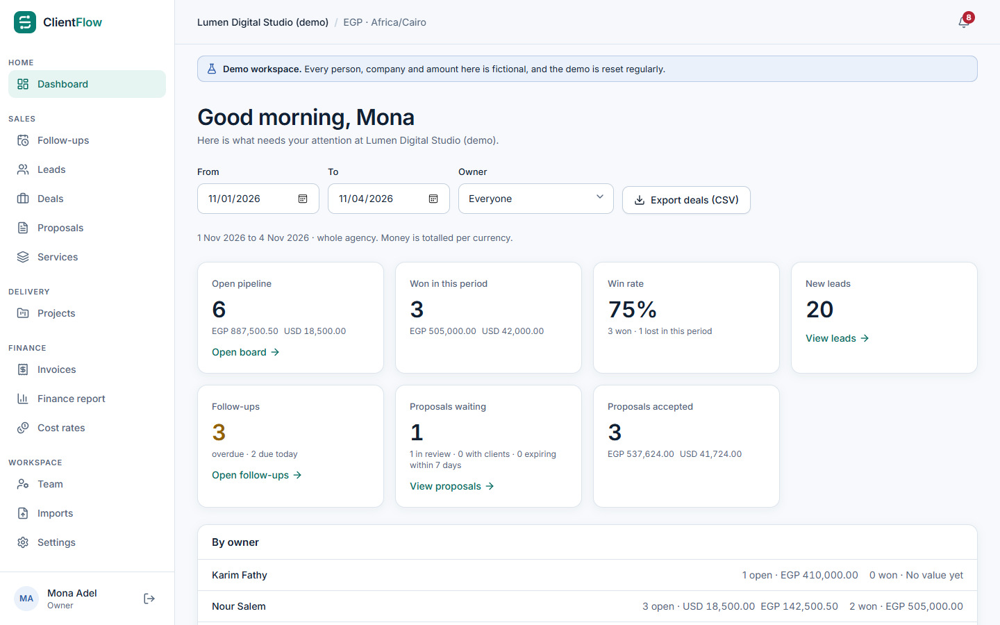
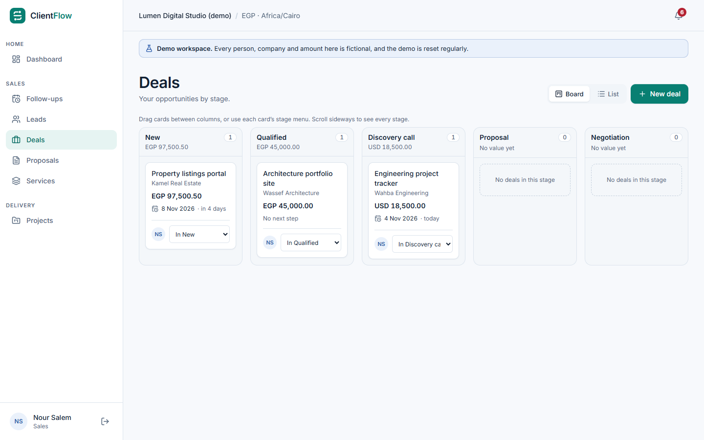
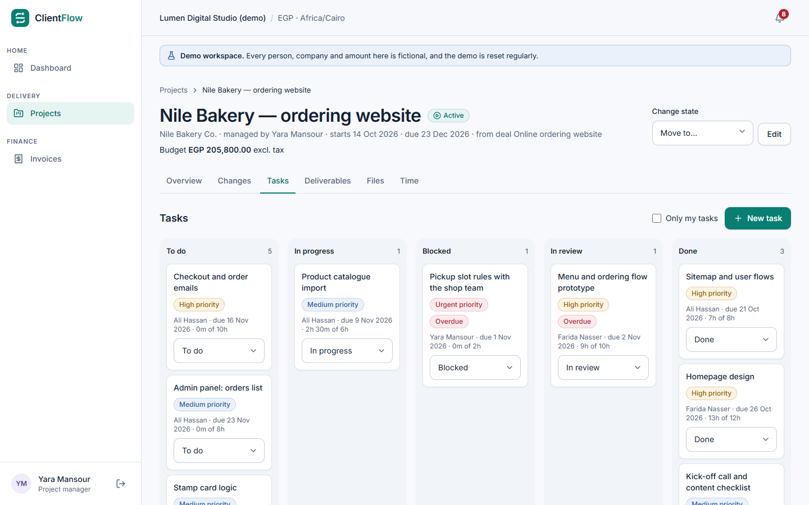
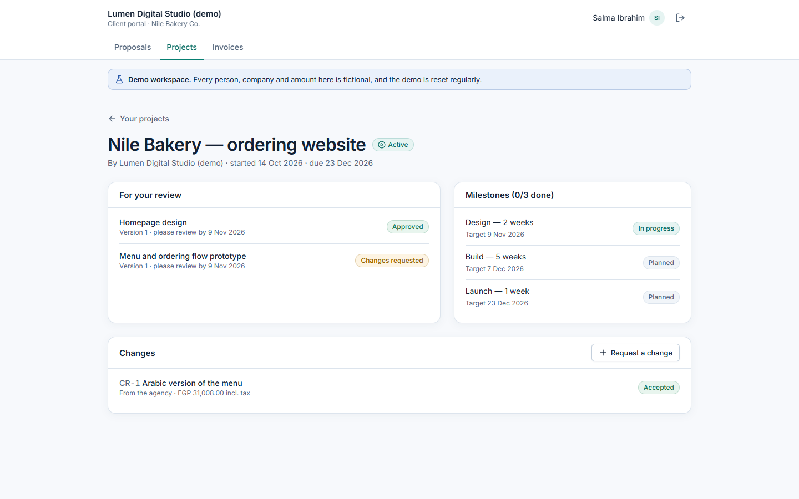
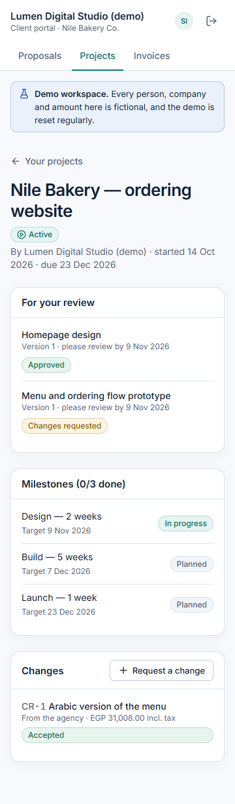
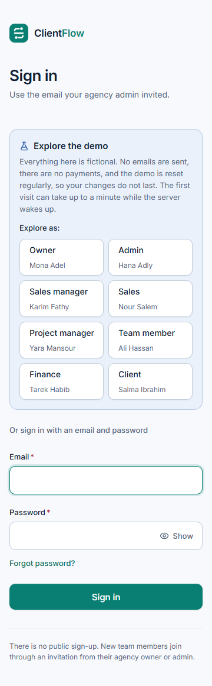
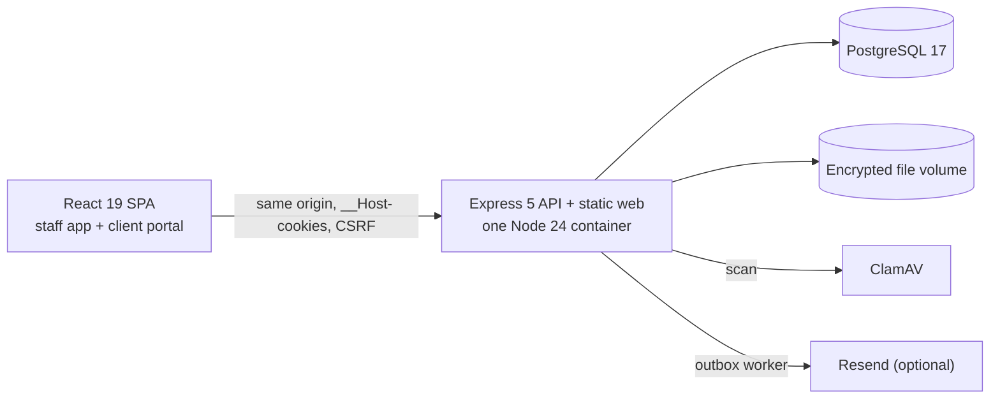

# ClientFlow

**Agency operations from the first lead to the last invoice, with a client portal that keeps every client's data apart.**

TypeScript · React 19 · Express 5 · PostgreSQL 17 · Prisma 7 · Playwright

> **Status: portfolio project.**
>
> - **Not in customer use:** no real agency or client has used it.
> - **Fictional data only:** every screenshot and the demo workspace use invented people and companies.
> - **Verified locally:** a production-like staging run was checked on a laptop (HTTPS, Postgres, ClamAV).
> - **Demo not live yet:** the public demo is configured but not deployed.
>
> See [what was verified](docs/27_RELEASE_QUALITY_PASSPORT.md).



## Contents

[Problem](#the-problem) · [Features](#what-it-does) · [Architecture](#architecture) · [Security](#security-in-brief) · [Testing](#verified-results) · [Run it](#run-it-locally) · [Demo](#demo-workspace) · [Limits and roadmap](#limitations-and-roadmap) · [How it was built](#how-it-was-built) · [Docs](#documentation)

## The problem

Small agencies run on a patchwork of tools: leads in a spreadsheet, quotes in documents, approvals in chat, tasks in one tool and invoices in another. Three things keep going wrong:

1. **Follow-ups slip.** Nobody sees which lead was promised a call yesterday.
2. **Scope creeps unpaid.** Small extra requests get done without a price or an approval.
3. **Approvals cannot be proven.** "Which version did the client accept?" has no reliable answer.

ClientFlow puts the whole path in one place and makes those three things visible and provable.

## What it does

```
Lead → Deal → Proposal (internal approval → client decision in the portal)
     → Project (tasks, time, deliverables, change requests) → Invoices and payments
```

| Role                | Main screens                                                                                                                                                                                                     |
| ------------------- | ---------------------------------------------------------------------------------------------------------------------------------------------------------------------------------------------------------------- |
| **Sales**           | Leads with follow-up queues (overdue / today / upcoming / no next step), a pipeline board with a keyboard stage menu, proposals with exact totals and VAT explained, and numbered versions that freeze once sent |
| **Sales manager**   | Internal approval before anything reaches a client, team dashboard, CSV import with preview and undo, CSV export                                                                                                 |
| **Project manager** | One-step, duplicate-proof handoff from a won deal; milestones and a handoff checklist; task board with dependencies; change requests priced and approved                                                         |
| **Member**          | Their tasks and time, encrypted file uploads, deliverable versions                                                                                                                                               |
| **Finance**         | Invoices numbered on issue (INV-0001…), partial payments and reversals, finance report per currency with aging, cost rates and estimated margin                                                                  |
| **Client** (portal) | Only their organization's proposals, shared projects, published deliverables and invoices; accept, ask for changes or reject                                                                                     |
| **Owner / Admin**   | Team and roles, invitations, two-step sign-in, agency settings, system status, audit trail                                                                                                                       |

| Sales pipeline                                            | Project task board                                            |
| --------------------------------------------------------- | ------------------------------------------------------------- |
|  |  |

| Client portal: a shared project                                       | The same screen at 360 px                                                       | Demo sign-in                                                             |
| --------------------------------------------------------------------- | ------------------------------------------------------------------------------- | ------------------------------------------------------------------------ |
|  |  |  |

## Architecture



- **One container** serves the API and the built web app on one origin (ADR-034).
- **Shared Zod contracts** between API and web.
- **A transactional outbox** for email and reminders.
- **46 Prisma models**, with `CHECK` constraints and freeze triggers in SQL.

More: [architecture overview with request pipeline, workflow and data-model diagrams](docs/25_ARCHITECTURE_OVERVIEW.md) · [full data model](docs/08_DATABASE_ERD.md) · [71 architecture decisions](docs/07_ARCHITECTURE_ADRS.md).

## Security in brief

- **Sign-in:**
  - Argon2id passwords;
  - opaque server sessions, stored only as hashes (idle and absolute expiry, shorter for Owners and Admins);
  - TOTP two-step sign-in, required for Owners and Admins in production;
  - no public sign-up.
- **Authorization on the server:**
  - eight roles plus per-record scope;
  - out-of-scope records answer 404;
  - a **permission matrix test tries every role against every protected API route**, and a route-inventory test fails if a route is left out of it.
- **Integrity:** sent proposals, change versions, issued invoices, payments and audit events are frozen by database triggers. Money is stored as integer minor units, and currencies are never mixed.
- **Files:**
  - type, signature and active-content checks;
  - ClamAV scanning (when configured) that fails closed;
  - AES-256-GCM encryption per file;
  - 5-minute download links bound to the user.
- **Platform:**
  - CSRF tokens plus Origin checks, CSP without inline scripts, HSTS;
  - brute-force limits shared in PostgreSQL;
  - gitleaks, CodeQL, Trivy and `npm audit` in CI.

This is a self-assessment. There has been **no external penetration test and no certification**. Details and known gaps: [security and testing overview](docs/26_SECURITY_AND_TESTING.md) · [threat model](docs/11_THREAT_MODEL.md) · [limited ASVS map](docs/12_ASVS_CHECKLIST.md).

## Verified results

Measured on 2026-11-04 at commit `448ecba` (current `main`, including the backend hardening PRs #127–#131) on one Windows laptop. The full list, including what failed and what was not run, is in the [Release Quality Passport](docs/27_RELEASE_QUALITY_PASSPORT.md).

| Check                                                    | Result                                                                            |
| -------------------------------------------------------- | --------------------------------------------------------------------------------- |
| API integration tests on real PostgreSQL                 | 454 passed, 1 skipped (real-ClamAV test; run separately in staging)               |
| Web component tests                                      | 95 passed                                                                         |
| End-to-end, Edge · Firefox · WebKit                      | 77 · 77 · 77 passed                                                               |
| Demo tour, every role, 3 engines                         | 27 passed                                                                         |
| Local production-like staging (HTTPS, ClamAV, Postgres)  | 28 checks passed, 1 skipped (proxy check needs a real host)                       |
| Backup → restore into an empty database                  | RECONCILED (46 tables, 18 migrations, every file decrypted and verified)          |
| Lint · types · format · build · `npm audit` (high)       | pass · pass · pass · pass · 0 vulnerabilities                                     |
| Lighthouse, lab data (earlier run, 2026-11-04 on `main`) | dashboard mobile 86 (target 90, not met) · login mobile 91 · dashboard desktop 99 |

**Not run:** a human screen-reader pass, real email delivery, any hosted deployment, or an external penetration test.

## Run it locally

Requires Node 24, Docker Desktop and Windows PowerShell. For other shells, see [Windows setup](docs/16_WINDOWS_SETUP.md).

```powershell
npm ci
Copy-Item .env.example .env   # replace every placeholder (docs/16_WINDOWS_SETUP.md)
npm run db:up                  # PostgreSQL 17 in Docker on port 5433
npm run db:migrate
npm run bootstrap:owner -- --agency "Your Agency" --name "Your Name" --email you@example.com
npm run dev                    # http://localhost:5173
```

| Check                       | Command                                                                                                        |
| --------------------------- | -------------------------------------------------------------------------------------------------------------- |
| Lint, types, format         | `npm run lint` · `npm run typecheck` · `npm run format:check`                                                  |
| API tests (real PostgreSQL) | `npm test`                                                                                                     |
| Web tests                   | `npm run test:web`                                                                                             |
| End-to-end                  | `npm run e2e` (Edge on Windows) · `E2E_BROWSER=firefox` / `webkit`                                             |
| Production-like staging     | `npm run staging:up` · `npm run staging:check` · `npm run staging:down` ([guide](docs/24_STAGING_AND_DEMO.md)) |

## Demo workspace

The demo is a separate, fictional agency built **through the real API**: people accept invitations, managers approve proposals and clients decide in the portal. So it can never show a state the product cannot reach.

```powershell
# DATABASE_URL must point at a database whose name contains "demo"
$env:DEMO_MODE = "true"; npm run demo:reset -- --confirm clientflow_demo
npm run demo:tour              # uses DEMO_DATABASE_URL, rebuilds the demo, walks every role in 3 engines
```

**In demo mode:**

- the sign-in page offers **"Explore as …"** buttons, one per role, so no password is ever published;
- every page shows a demo banner;
- no email is sent;
- the server refuses account, invitation, agency-settings, upload, file-delete and import actions with `403 DEMO_RESTRICTED`;
- changes are capped per address;
- the public deployment rebuilds the demo on every start.

The free hosting plan (Render Free + Neon Free, no payment card) is in [`docs/24_STAGING_AND_DEMO.md`](docs/24_STAGING_AND_DEMO.md). It is **not deployed yet**.

## Limitations and roadmap

**Known limitations:**

- **No real users yet.** The pilot plan is ready: [`docs/22_PILOT_PLAN.md`](docs/22_PILOT_PLAN.md).
- **Not deployed.**
  - Local production-like staging is verified.
  - The free public demo and the paid pilot staging are configured but not applied.
- **Accessibility:** axe checks, keyboard tests and 360 px to 400 % zoom checks pass. A human screen-reader pass has not been done.
- **Some lists are capped** (projects, proposals and portal invoices at 200, invoices and tasks at 500) with no paging yet. This is QA finding Q1.
- **Not accounting software and not an e-signature tool.** Invoices are tracked; a client acceptance is an operational approval.
- **TOTP is not phishing-resistant.** Passkeys are on the roadmap.

**Roadmap:**

1. Paging for capped lists.
2. Scanner status in `/health/ready`.
3. Deploy the public demo.
4. Pilot with one agency.
5. Screen-reader pass.
6. Passkeys.
7. Generated PDF invoices.

## How it was built

The owner wrote the product specification ([`CLIENTFLOW_MASTER_SPEC.md`](CLIENTFLOW_MASTER_SPEC.md)) and set the milestone gates. The code, tests and documents were written with **Claude Code, an AI coding agent**, working milestone by milestone (M0–M12.1, then security hardening, QA and demo hosting).

Every milestone ended with:

- a report that separates implemented, tested, failed and not run;
- a traceability update;
- a pull request with CI;
- the owner's explicit approval before the next one started.

The [milestone reports](docs/milestones/) and the commit history show each step, including the failures and their fixes.

## Documentation

| Topic                                 | Document                                                                                                                                                                                                |
| ------------------------------------- | ------------------------------------------------------------------------------------------------------------------------------------------------------------------------------------------------------- |
| Product specification                 | [`CLIENTFLOW_MASTER_SPEC.md`](CLIENTFLOW_MASTER_SPEC.md)                                                                                                                                                |
| Case study                            | [`docs/21_PORTFOLIO_CASE_STUDY.md`](docs/21_PORTFOLIO_CASE_STUDY.md)                                                                                                                                    |
| Release Quality Passport              | [`docs/27_RELEASE_QUALITY_PASSPORT.md`](docs/27_RELEASE_QUALITY_PASSPORT.md)                                                                                                                            |
| QA release report                     | [`docs/23_QA_RELEASE_REPORT.md`](docs/23_QA_RELEASE_REPORT.md)                                                                                                                                          |
| Architecture · data model · decisions | [overview](docs/25_ARCHITECTURE_OVERVIEW.md) · [ERD](docs/08_DATABASE_ERD.md) · [ADRs](docs/07_ARCHITECTURE_ADRS.md)                                                                                    |
| Security · privacy · operations       | [overview](docs/26_SECURITY_AND_TESTING.md) · [threat model](docs/11_THREAT_MODEL.md) · [ASVS map](docs/12_ASVS_CHECKLIST.md) · [privacy](docs/18_PRIVACY_RETENTION.md) · [runbook](docs/19_RUNBOOK.md) |
| Deployment · staging and demo         | [deployment](docs/17_DEPLOYMENT.md) · [staging and demo](docs/24_STAGING_AND_DEMO.md) · [release checklist](docs/15_RELEASE_CHECKLIST.md)                                                               |
| Setup · user guides                   | [Windows setup](docs/16_WINDOWS_SETUP.md) · [guides by role](docs/guides/README.md)                                                                                                                     |
| Milestones · risks · traceability     | [reports](docs/milestones/) · [risk register](docs/RISK_REGISTER.md) · [requirements traceability](docs/REQUIREMENTS_TRACEABILITY.csv)                                                                  |
| Portfolio materials                   | [description](docs/portfolio/PORTFOLIO_DESCRIPTION.md) · [LinkedIn](docs/portfolio/LINKEDIN.md) · [video storyboard](docs/portfolio/DEMO_VIDEO_STORYBOARD.md)                                           |

## Security reports and licence

Please report vulnerabilities privately to the maintainer, not in public issues. No real client data belongs in this repository: all seed, test and demo data is fictional.

Released under the [MIT License](LICENSE).
