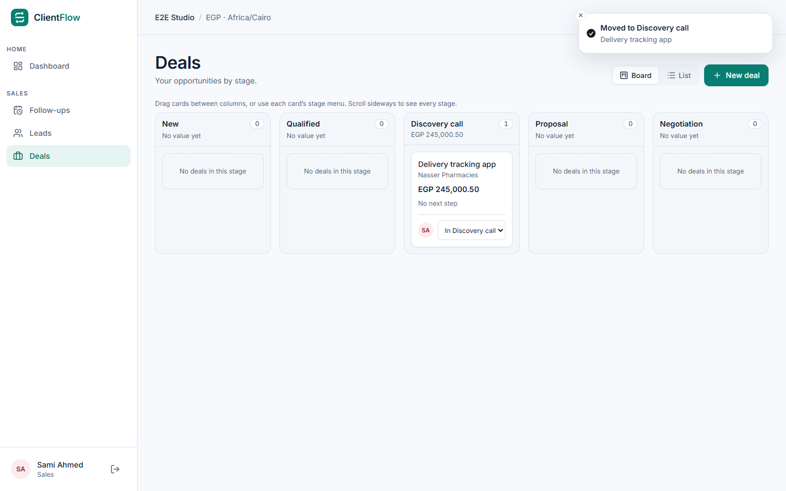

# ClientFlow

A secure **agency operations platform** for a single software & digital agency. It covers the path from lead → deal → versioned proposal → project handoff → tasks and deliverables → change requests → invoice tracking, plus an isolated client portal.

> **Status: M3 (sales CRM) complete on `feat/m3-sales-crm`, stacked on M2 and M1.** Leads, a deal pipeline with exact multi-currency money, a follow-up queue, owner bootstrap, invitations, password reset and a declarative permission matrix run on real PostgreSQL. 173 API, 33 UI and 17 end-to-end tests pass locally. Nothing here is production-ready yet; see each milestone report.



## What works today (M1 to M3)

- CLI-only owner bootstrap (refuses a second run). No public sign-up.
- Email + password sign-in with Argon2id, hashed server sessions, idle and absolute expiry, logout revocation, CSRF + Origin checks, login throttling.
- Leads: add, edit, archive/restore, convert to customer, reassign, and a timeline of notes, calls, emails and meetings. Filters for owner, source and follow-up state. Salespeople see only their own leads; managers see the whole agency. Enforced on the server and tested with direct API calls.
- Deals: a pipeline board (drag and drop, or a keyboard-friendly stage menu) and a list view. Amounts are exact, with totals kept per currency. Stale edits are refused (409). Won/lost need a reason, and closing twice records one event.
- Follow-ups: overdue, due today, upcoming and no-next-step queues in the agency timezone.
- Team page: invite by email with one-time links, change roles, deactivate/reactivate, sign out everywhere. The last owner can never be removed.
- Forgot/reset password with single-use 30-minute links. Development emails go to a local sink, never sent.
- Offline breached/weak password check (zxcvbn-ts).
- Responsive UI from 360px to 1920px, with keyboard support and axe checks.
- CI on every push: lint, typecheck, dependency audit, tests on Postgres, Playwright E2E, build, secret scan.

## Docs

- **Product source of truth:** [`CLIENTFLOW_MASTER_SPEC.md`](CLIENTFLOW_MASTER_SPEC.md)
- **Windows setup:** [`docs/16_WINDOWS_SETUP.md`](docs/16_WINDOWS_SETUP.md)
- **Milestone reports:** [M1](docs/milestones/M1_REPORT.md) · [M2](docs/milestones/M2_REPORT.md) · [M3](docs/milestones/M3_REPORT.md)
- **Requirements traceability:** [`docs/REQUIREMENTS_TRACEABILITY.csv`](docs/REQUIREMENTS_TRACEABILITY.csv)
- **Architecture decisions:** [`docs/07_ARCHITECTURE_ADRS.md`](docs/07_ARCHITECTURE_ADRS.md)
- **Risks:** [`docs/RISK_REGISTER.md`](docs/RISK_REGISTER.md)
- **Task tracking:** GitHub [milestones](../../milestones) and [issues](../../issues)

## Stack

React 19 + TypeScript + Vite + React Router + TanStack Query + Tailwind CSS 4 · Express 5 + Zod 4 · PostgreSQL 17 + Prisma 7 · Vitest, Supertest, Testing Library, Playwright + axe.

## Quick start (Windows PowerShell)

```powershell
npm ci
Copy-Item .env.example .env   # then replace every placeholder (see docs/16_WINDOWS_SETUP.md)
npm run db:up
npm run db:migrate
npm run bootstrap:owner -- --agency "Your Agency" --name "Your Name" --email you@youragency.com
npm run dev                    # http://localhost:5173
```

Checks: `npm run lint`, `npm run typecheck`, `npm test`, `npm run test:web`, `npm run e2e`, `npm run build`.

## Security

Do not open public issues for vulnerabilities. Contact the maintainer privately. No real client data belongs in this repository: all seed and test data is fictional.
