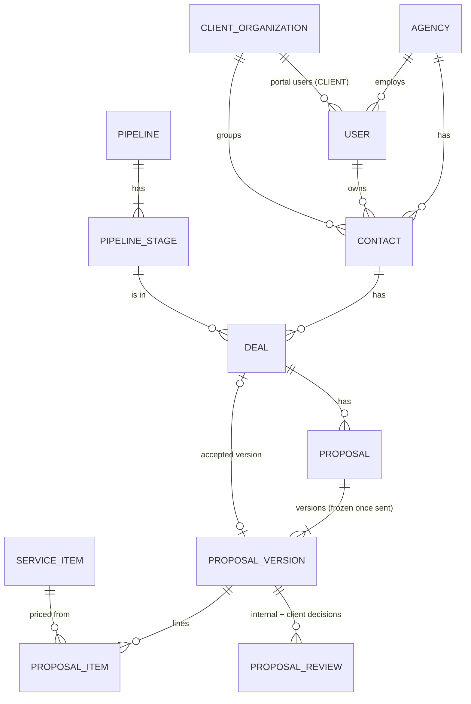
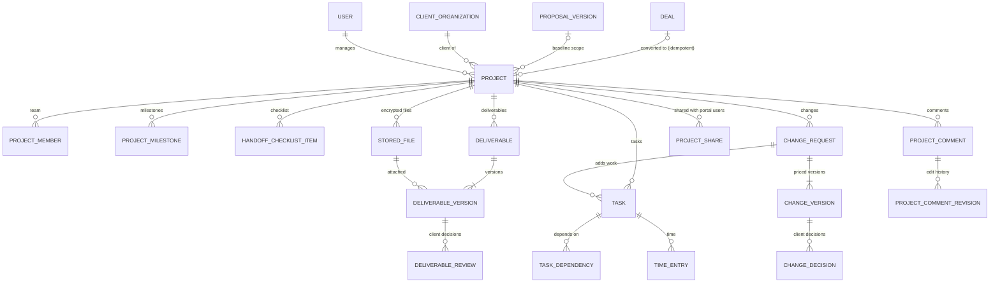
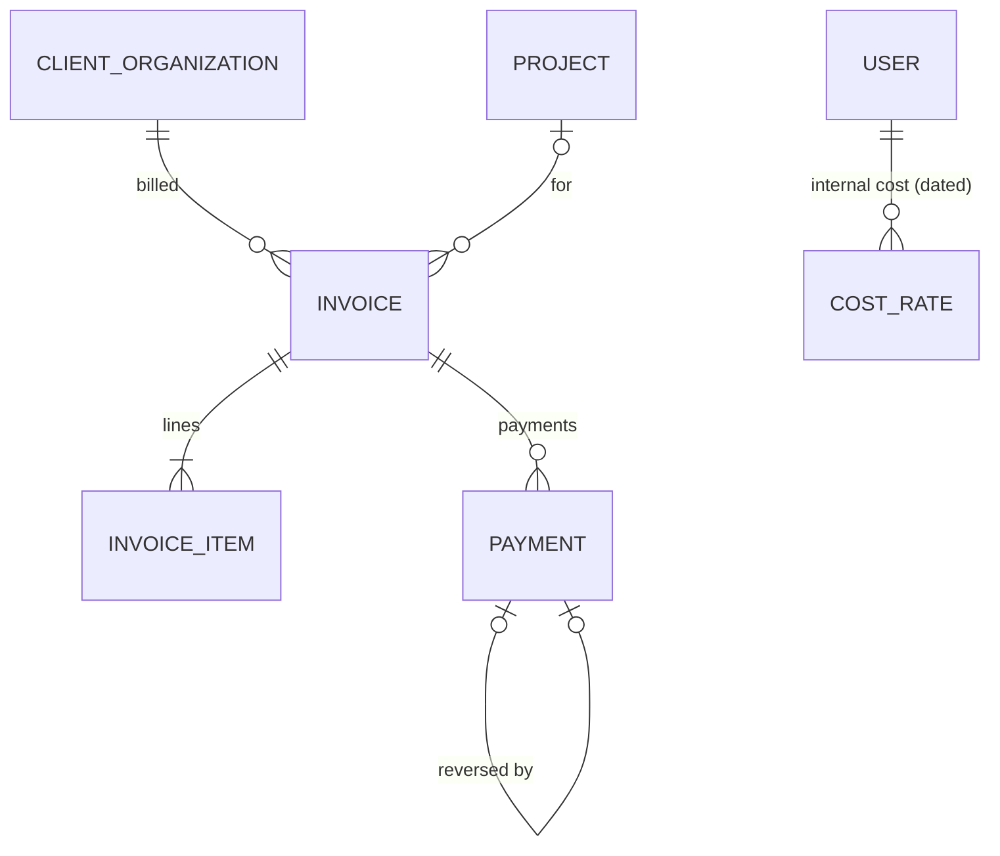

# Data model (PostgreSQL 17)

The source of truth is [`prisma/schema.prisma`](../prisma/schema.prisma) and the SQL migrations in
[`prisma/migrations`](../prisma/migrations). This page is a map of the 44 tables, not a copy of
them. Generated from the schema at M12.

## Conventions

- **One agency per installation** (spec §0.2). Most tables still carry `agency_id`, and composite
  foreign keys such as `(agency_id, owner_id)` stop a row from pointing into another agency.
- **IDs** are UUIDv7 (time-ordered). **Money** is a `bigint` in minor units with a `char(3)` currency;
  amounts in different currencies are never summed.
- **Optimistic locking:** editable rows have a `version` integer. A stale write is refused with
  `409 CONFLICT_STALE_VERSION`.
- **Frozen history:** sent proposal versions, sent change versions, issued invoices and audit events
  cannot change. Database triggers enforce it, not just the API.
- **Checks in the database:** non-empty names, date order, valid states, non-negative money, and
  similar rules are `CHECK` constraints, so a bug in the API cannot store them.

## Sales: leads to accepted proposals

## Delivery: projects, work and client approvals

## Finance

Invoice lines can point to a project milestone or an accepted change request (`source`,
`source_id`). Invoice numbers come from a per-agency counter that only advances when an invoice is
issued.

## Identity, audit and operations

| Table                                       | Holds                                                                  |
| ------------------------------------------- | ---------------------------------------------------------------------- |
| `users`, `invitations`                      | Staff and portal users; invitations store only a hash of the token     |
| `sessions`, `password_reset_tokens`         | Hashes only, with idle/absolute expiry; pruned 30 days after they end  |
| `audit_events`                              | Append-only record of security and business events (trigger-protected) |
| `activities`                                | Timelines shown on leads, deals and projects                           |
| `idempotency_records`                       | Replays for "create once" requests (project conversion, invoices, …)   |
| `outbox_jobs`                               | Emails and reminder scans, claimed with `SKIP LOCKED`, retried, buried |
| `notifications`, `notification_preferences` | In-app notifications and each user's channel choices                   |
| `import_runs`                               | CSV imports, so an import can be undone                                |
| `rate_limit_counters`                       | Sign-in and one-time-link limits shared by every instance              |
| `agencies`                                  | Profile, defaults, number counters, and `is_demo` for a demo workspace |
