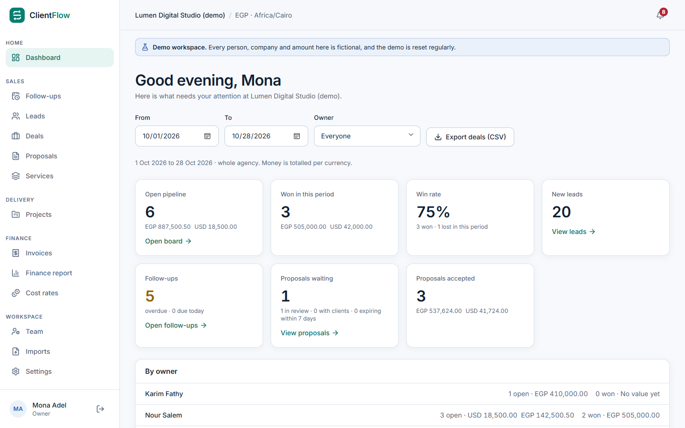
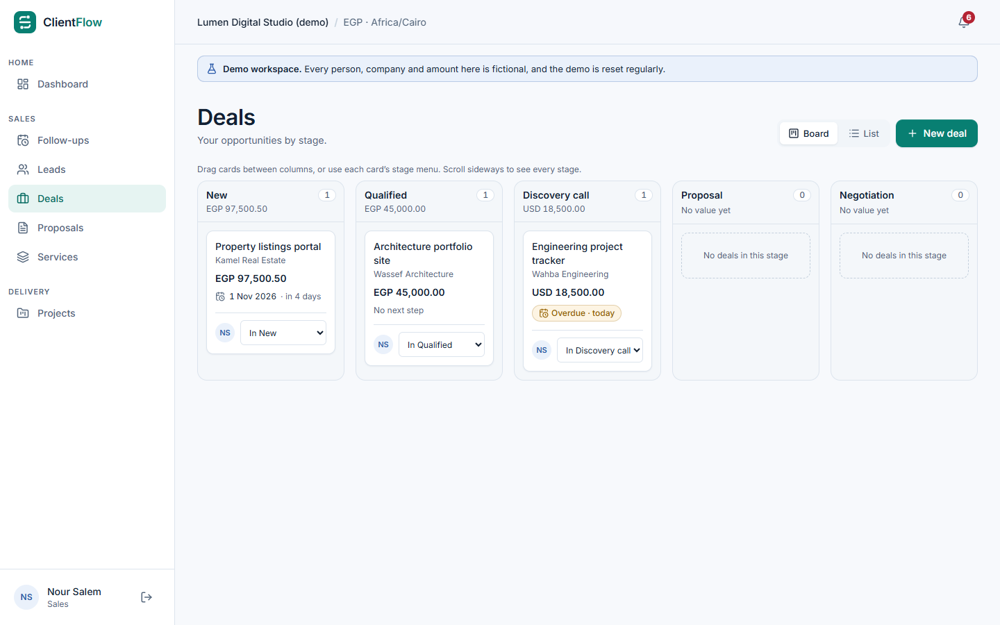
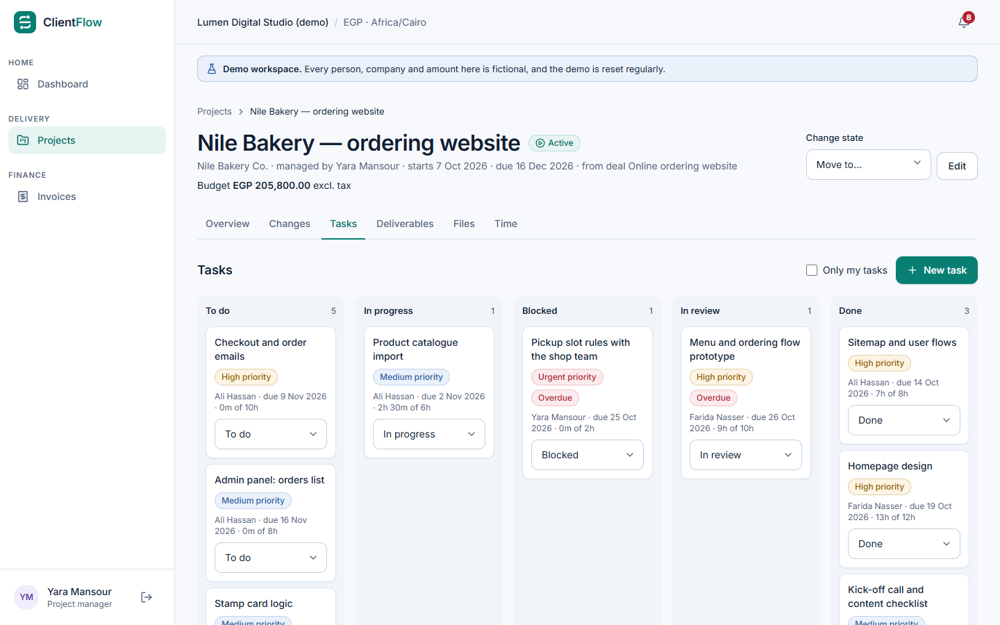
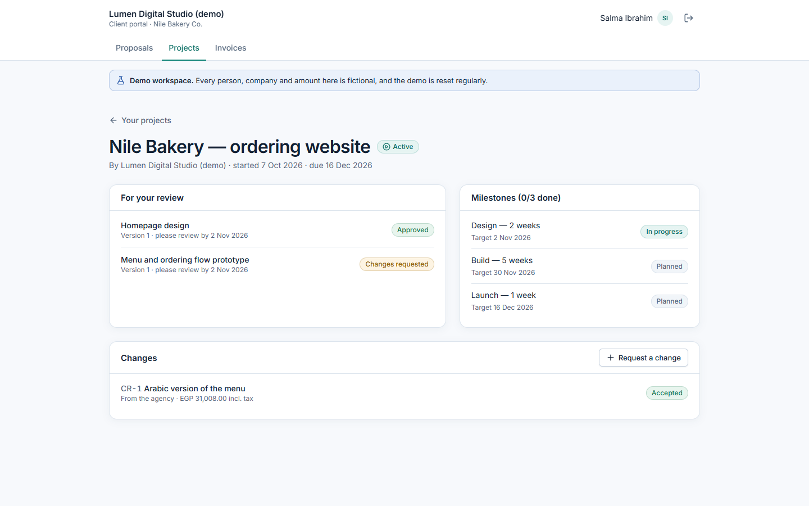
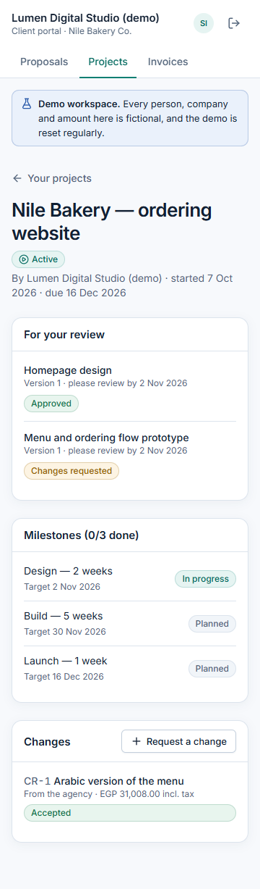

# Case study: ClientFlow

**An operations platform for a small software and digital agency: from the first lead to the last
invoice, with a client portal that keeps every client's data apart.**



## The problem

Small agencies run on a patchwork: leads in a spreadsheet, quotes in documents, approvals in chat,
tasks in one tool and invoices in another. Three things go wrong again and again:

1. **Follow-ups slip.** Nobody sees which lead was promised a call yesterday.
2. **Scope creeps unpaid.** "Small" extra requests are done without a price or an approval.
3. **Approvals cannot be proven.** "Which version did the client accept?" has no reliable answer.

ClientFlow puts the whole path in one place and makes those three things visible and provable.

## What it does

```
Lead → Deal → Proposal (internal approval → client decision in the portal)
     → Project (tasks, time, deliverables, change requests)
     → Invoices and payments
```

| For               | They get                                                                                                    |
| ----------------- | ----------------------------------------------------------------------------------------------------------- |
| Sales             | Leads with follow-up queues, a pipeline board, proposals with exact totals and numbered, frozen versions    |
| Sales managers    | Approval before anything reaches a client, team dashboard, CSV export and import                            |
| Project managers  | One-step, duplicate-proof handoff from won deal to project; task board; change requests priced and approved |
| Team members      | Their tasks and time, encrypted file uploads, deliverables with client feedback                             |
| Finance           | Invoices numbered on issue, partial payments with reversals, finance report per currency                    |
| Clients           | A portal with only their own proposals, shared projects, deliverables and invoices                          |
| Owners and admins | Team, roles, settings, system status, backups and an audit trail                                            |

| Sales pipeline                                                     | Project task board                                                     |
| ------------------------------------------------------------------ | ---------------------------------------------------------------------- |
|  |  |

| Client portal: a shared project                                                | The same screen on a phone (360 px)                                          |
| ------------------------------------------------------------------------------ | ---------------------------------------------------------------------------- |
|  |  |

All screenshots show the **fictional demo workspace** (`npm run demo:reset`). No real client data
was ever used.

## How it was built

- **Stack:** TypeScript end to end. Express 5 API, PostgreSQL 17 through Prisma 7, React 19 with
  TanStack Query and Tailwind 4, Zod schemas shared by the API and the web app. One container serves
  both.
- **Milestones with gates.** Twelve milestones, each a vertical slice from database to screen. Each
  ended with an honest report (implemented / tested / not run / failed), a traceability update, a
  pull request with CI, and an explicit go-ahead from the owner before the next started.
- **Tests that attack the API, not just the screens.** Every role is tried against every endpoint
  (155 of them) to prove that hidden buttons are never the only protection. Integration tests run on
  real PostgreSQL; end-to-end tests drive real browsers with accessibility checks and a 360 px
  overflow check on every main screen.
- **The demo is built by the product itself.** `demo:reset` creates its data through the real API:
  people accept invitations, managers approve proposals, clients decide in the portal. So the demo
  can never show a state the product cannot reach.

## Engineering decisions worth a closer look

66 decisions are recorded in [`07_ARCHITECTURE_ADRS.md`](07_ARCHITECTURE_ADRS.md). A few that shaped
the product:

| Decision                                                                                             | Why                                                                           |
| ---------------------------------------------------------------------------------------------------- | ----------------------------------------------------------------------------- |
| Server sessions (hashed opaque tokens) instead of JWTs                                               | Instant revocation on sign-out or deactivation; nothing secret in the browser |
| A record outside your scope answers **404**, not 403                                                 | Users cannot discover what exists elsewhere                                   |
| Sent proposal versions, change versions, issued invoices and payments are frozen **in the database** | Approvals stay provable even if the API had a bug                             |
| A client decision carries the hash of the exact version shown                                        | "Which version did they accept?" always has one answer                        |
| Money as integer minor units with a currency, never summed across currencies                         | No rounding drift; no meaningless EGP + USD totals                            |
| Idempotency keys on project conversion, invoices and payments                                        | A double-click or retry never creates a second project or payment             |
| Transactional outbox for email and reminders                                                         | No email for a change that rolled back; retries without duplicates            |
| Extra work must point to an accepted change request, or carry a written reason                       | Scope creep becomes visible instead of silent                                 |
| Files encrypted per file (AES-256-GCM), downloaded via 5-minute links bound to the user              | A leaked folder or link is not enough to read client work                     |
| Compress static files only, never API JSON                                                           | Avoids the BREACH side channel                                                |

## Results

| Measure                     | Result                                                                                                      |
| --------------------------- | ----------------------------------------------------------------------------------------------------------- |
| Automated tests             | See the M12 report for the final counts (API on PostgreSQL, web, end-to-end)                                |
| Role × endpoint checks      | 155 endpoints, every role                                                                                   |
| Browsers                    | Full end-to-end suite passes in Edge, Firefox and WebKit (WebKit found a real drag-and-drop bug, now fixed) |
| Screen widths               | 360, 390, 768, 1024, 1280, 1440 and 1920 px, plus 200% and 400% zoom, without page-level sideways scrolling |
| API speed (local, 10 users) | p95 36–136 ms for reads, 60 ms for writes, with about 2,000 contacts                                        |
| Restore drill               | 43 tables and every stored file reconciled after restoring into an empty database                           |
| Production image            | 518 MB, scanned in CI (Trivy, CodeQL, gitleaks, npm audit)                                                  |
| Lighthouse (mobile profile) | Sign-in 87–89; dashboard 84–86 on the demo data (desktop 91–99)                                             |

## Limits, stated plainly

- **Not deployed.** Hosting and an email provider are still to be chosen.
- **No real users have tested it yet.** The pilot plan is ready ([`22_PILOT_PLAN.md`](22_PILOT_PLAN.md)).
- **No multi-factor sign-in and no antivirus engine for uploads** yet
  ([threat model](11_THREAT_MODEL.md)).
- **Accessibility:** automated axe checks, keyboard tests and zoom/reflow checks pass; a
  screen-reader session has not been done.
- **Not accounting software and not e-signature:** invoices are tracked operationally, and a client
  acceptance is an operational approval, not a legal signature.
- Measurements come from one Windows laptop, not a hosted environment.

## My role

I defined the product and its rules, set the milestone gates, reviewed each report and decided what
shipped, what waited and which trade-offs to accept. The code, tests and documents were written with
**Claude Code** (an AI coding agent) working under those gates: nothing was merged without passing
tests and my approval. The commit history and the milestone reports show every step, including what
failed and how it was fixed.

## Try it

```bash
npm ci
npm run db:up
DEMO_MODE=true npm run demo:reset -- --confirm clientflow_demo   # with DATABASE_URL set to the demo database
npm run demo:tour                                               # walks every role in three browser engines
```

See the [Windows setup](16_WINDOWS_SETUP.md), the [user guides](guides/README.md) and the
[deployment guide](17_DEPLOYMENT.md#demo-workspace).
