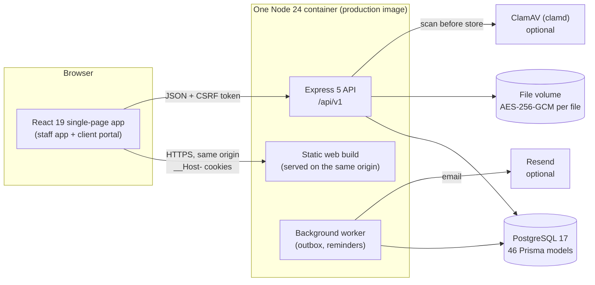
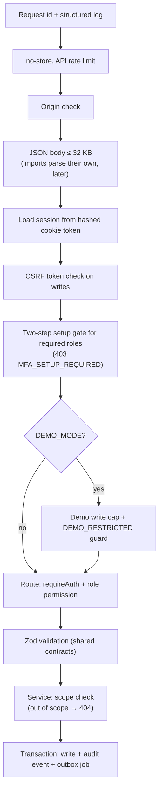
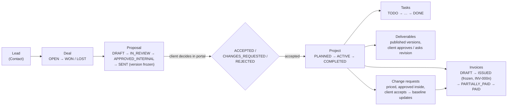
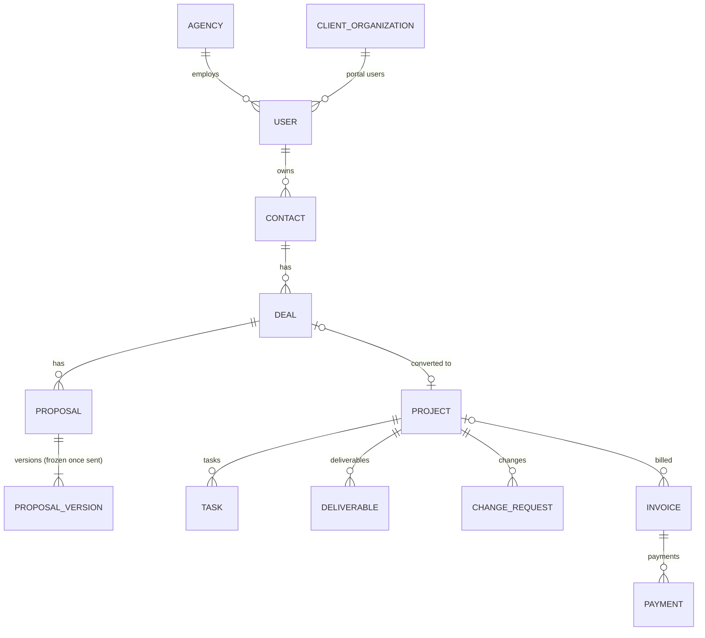
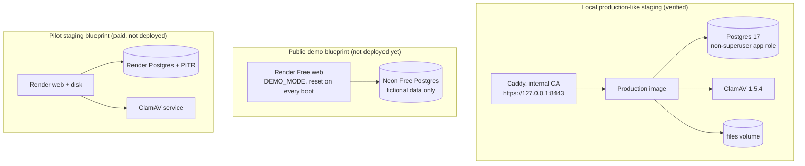

# Architecture overview

A one-page map of how ClientFlow is put together. The detailed sources are:

- the [data model](08_DATABASE_ERD.md);
- the [architecture decisions](07_ARCHITECTURE_ADRS.md) (ADR-001 to ADR-071);
- the [threat model](11_THREAT_MODEL.md);
- the [deployment guide](17_DEPLOYMENT.md).

## 1. System view

- **One deployable.** The API serves the built web app on the same origin. That gives one origin for cookies, CSP and CORS, and one image to scan and roll back (ADR-034).
- **The worker runs inside the API process** by default and claims jobs with `SKIP LOCKED`. It can run as a separate process instead (ADR-058).
- **Optional services** are refused at start-up when they are half-configured. Two examples:
  - production refuses to start without either ClamAV or an explicit `UPLOAD_SCAN=builtin-only`;
  - a demo refuses any mail transport that sends.

## 2. Request pipeline

Every `/api/v1` request passes these steps in order (`apps/api/src/app.ts`). A request that fails a step never reaches the next.

## 3. Business workflow

The path the product is built around. Each box is a real state machine in the database (`prisma/schema.prisma` enums). Frozen states are protected by database triggers, not only by the API.

**Rules that keep the path honest:**

- An accepted proposal records the hash of the exact version the client saw (ADR-031).
- Converting a deal into a project is idempotent, so a retry never creates a second project.
- Extra work has to point to an accepted change request or carry a written exception.
- Invoice numbers advance only when an invoice is issued. Payments are reversed, never edited.

## 4. Core data model (condensed)

Twelve of the 46 models. The full map, by area, is in [`08_DATABASE_ERD.md`](08_DATABASE_ERD.md).

**Conventions:**

- IDs are UUIDv7.
- Money is integer minor units with a currency, and different currencies are never summed.
- Editable rows carry a `version` for optimistic locking (`409` on a stale write).
- Composite foreign keys keep a row inside its agency.

## 5. Code layout

| Path                      | What lives there                                                                                                                                                        |
| ------------------------- | ----------------------------------------------------------------------------------------------------------------------------------------------------------------------- |
| `packages/contracts`      | Zod schemas, roles, error codes, shared by API and web                                                                                                                  |
| `apps/api/src/modules/*`  | One folder per area (auth, contacts, deals, proposals, projects, tasks, files, deliverables, changes, invoices, portal, imports, ops, demo, …): routes, service, policy |
| `apps/api/src/middleware` | Sessions, CSRF, Origin, rate limits, MFA gate, demo guard, security headers                                                                                             |
| `apps/api/src/jobs`       | Outbox worker and reminder scans                                                                                                                                        |
| `apps/api/src/demo`       | Demo builder: creates the fictional workspace through the real API                                                                                                      |
| `apps/web/src/features/*` | Screens per area, TanStack Query hooks, role-aware navigation                                                                                                           |
| `prisma/`                 | Schema, SQL migrations with `CHECK` constraints and freeze triggers                                                                                                     |
| `e2e/`                    | Playwright suites per milestone, plus the demo tour                                                                                                                     |

## 6. Deployment shapes

The trade-offs, the free-tier limits and the owner steps are in [`24_STAGING_AND_DEMO.md`](24_STAGING_AND_DEMO.md).
