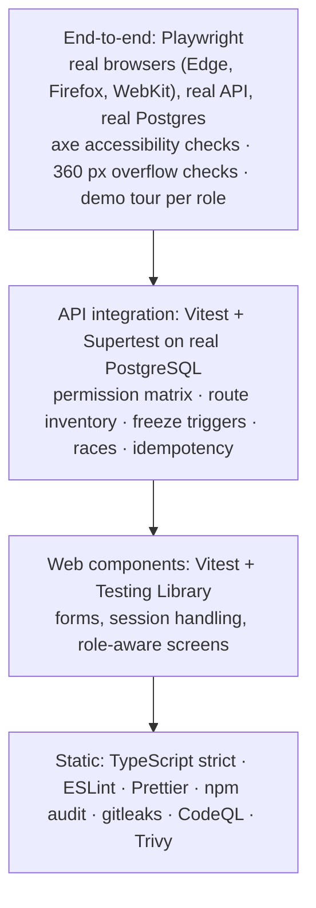

# Security and testing overview

How ClientFlow signs people in, decides what they may see, protects data, and how all of that is tested. This page is a summary. The evidence is in:

- the [threat model](11_THREAT_MODEL.md) and the [limited ASVS map](12_ASVS_CHECKLIST.md);
- the [QA release report](23_QA_RELEASE_REPORT.md);
- the [Release Quality Passport](27_RELEASE_QUALITY_PASSPORT.md), which has the measured numbers.

> **Scope of assurance.** All of this is self-assessed: design reviews, automated tests and automated scanners. There has been **no external penetration test, no third-party audit and no certification**. Statements like "met" in the ASVS map are the project's own judgement.

## 1. Authentication

| Control           | How                                                                                                                                                                                                                                                                                          |
| ----------------- | -------------------------------------------------------------------------------------------------------------------------------------------------------------------------------------------------------------------------------------------------------------------------------------------- |
| No public sign-up | The first owner comes from a CLI bootstrap that refuses a second run. Everyone else joins by invitation (ADR-010)                                                                                                                                                                            |
| Passwords         | At least 12 characters; checked offline for strength and against common passwords with zxcvbn-ts; stored with **Argon2id** (ADR-003, ADR-019)                                                                                                                                                |
| Sessions          | Opaque 256-bit tokens; only a hash is stored. `HttpOnly`, `SameSite=Lax` cookies, with the `__Host-` prefix and `Secure` in production. Expiry: 12 h idle / 7 days absolute, and **1 h / 24 h for Owners and Admins**. Revoked on sign-out, deactivation and "sign out everywhere" (ADR-002) |
| Two-step sign-in  | Authenticator-app codes (TOTP), protected against replay, plus hashed recovery codes. **Required for Owners and Admins in production** (ADR-069). Not phishing-resistant; passkeys are a roadmap item                                                                                        |
| One-time links    | Invitations and password resets: hashed at rest, single use, expiring, carried in the URL fragment (ADR-017)                                                                                                                                                                                 |
| Brute force       | Per-IP and per-email sign-in limits, shared in PostgreSQL so they hold across instances (ADR-062). Per-account limits on two-step codes                                                                                                                                                      |

## 2. Authorization

- **Eight roles:** Owner, Admin, Sales manager, Sales, Project manager, Member, Finance, Client. Permissions are decided on the server for every request; hiding a button is never the only protection.
- **Scope on top of role.** Salespeople see their own leads and deals; project managers and members see their projects; clients see only what was shared with their organization or with them personally.
- **Out of scope answers 404, not 403**, so nobody can probe what exists elsewhere (ADR-040, ADR-046).
- **The permission matrix test tries every role against every protected API route.** A route-inventory test reads `app.ts` and fails if a route is neither in the matrix nor in a short list of public, one-time-token and demo-only routes, each with the test that covers it.

## 3. Protecting data and the API

| Area         | Control                                                                                                                                                                                                                                                                                                                                         |
| ------------ | ----------------------------------------------------------------------------------------------------------------------------------------------------------------------------------------------------------------------------------------------------------------------------------------------------------------------------------------------- |
| CSRF         | Session-bound synchronizer token plus a strict Origin check on every write; CORS closed (ADR-004, ADR-005)                                                                                                                                                                                                                                      |
| Headers      | CSP `default-src 'self'` with no inline script, `frame-ancestors 'none'`, HSTS in production, `nosniff`, a strict referrer policy; API responses are `no-store`                                                                                                                                                                                 |
| Input        | Shared Zod schemas, strict JSON bodies of at most 32 KB, and database `CHECK` constraints as a second line of defence                                                                                                                                                                                                                           |
| Files        | Allowlist of types, signature and active-content checks, size and quota limits, **ClamAV scanning that fails closed** (when `CLAMAV_HOST` is set; production must otherwise opt out explicitly with `UPLOAD_SCAN=builtin-only`), AES-256-GCM encryption per file, and downloads through 5-minute links bound to the user (ADR-043–045, ADR-070) |
| Integrity    | Sent proposals, change versions, issued invoices, payments and audit events are frozen by **database triggers** (ADR-030, ADR-054, ADR-055)                                                                                                                                                                                                     |
| Money        | Integer minor units with a currency; never summed across currencies (ADR-006, ADR-023)                                                                                                                                                                                                                                                          |
| Retries      | Idempotency keys on project conversion, invoices and payments; transactional outbox for email (ADR-038, ADR-058)                                                                                                                                                                                                                                |
| Compression  | Static files only, never API JSON (BREACH) (ADR-065)                                                                                                                                                                                                                                                                                            |
| Secrets      | Only from the environment; production refuses placeholders. gitleaks runs in CI; generated local secrets are git-ignored                                                                                                                                                                                                                        |
| Supply chain | `npm audit`, CodeQL, Trivy scan of the runtime image, Dependabot, actions pinned by commit SHA                                                                                                                                                                                                                                                  |
| Audit trail  | Append-only `audit_events` for security and business events, with request ids in the logs                                                                                                                                                                                                                                                       |
| Public demo  | `DEMO_MODE` refuses account, invitation, agency, upload, file-delete and import actions with `403 DEMO_RESTRICTED`; caps changes per address; sends no email; rebuilds fictional data on every start (ADR-066, ADR-071)                                                                                                                         |

**Known gaps** (the full list is in the Passport):

- no external penetration test;
- TOTP is not phishing-resistant;
- the general API rate limit is per instance;
- `/health/ready` does not report the virus scanner (finding Q3).

## 4. Testing methodology

**Principles:**

- **Integration tests use a real database**, never mocks of Prisma. Constraint and trigger behaviour is exactly what a mock would hide.
- **Attack the API, not only the UI.** Each role is tried directly against routes it must not reach.
- **Three browser engines.** WebKit found a real drag-and-drop bug in M12.
- **A test that did not run is never counted as passed.** Reports list NOT RUN items separately, and a failure under machine load is reported, then rerun on a quiet machine. It is not hidden.
- **Operational drills:**
  - a backup → isolated restore drill that reconciles every table and stored file;
  - a local production-like staging check: HTTPS, cookies, headers, CSRF/Origin, ClamAV, worker.

**What is not covered by automation:**

- a human screen-reader pass (NFR-04);
- real email delivery;
- a hosted deployment's network;
- load beyond one laptop.

The measured results, with commit SHA, date and environment, are in the [Release Quality Passport](27_RELEASE_QUALITY_PASSPORT.md).
